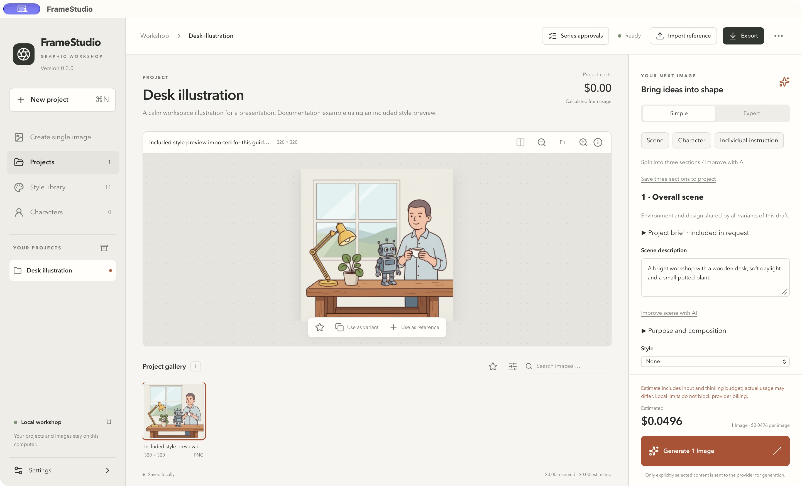

# FrameStudio

[](https://github.com/YorkStack/FrameStudio/actions/workflows/build.yml)
[](https://github.com/YorkStack/FrameStudio/releases/latest)
[](LICENSE)

A local image workshop for macOS and Windows. Create images with Google Gemini or OpenAI using your own API key, organize them in projects with reusable scenes and characters, and export them as PNG, PDF, PowerPoint, sprite sheets and more. Your projects stay on your computer.

**Documentation:** English (below) · **[Deutsche Dokumentation](docs/de/README.md)**



## Install

Download the latest version from the **[release page](https://github.com/YorkStack/FrameStudio/releases/latest)**. No Docker, database server, Node or Rust installation is needed.

### macOS (Apple Silicon)

1. Open `FrameStudio_<version>_aarch64.dmg` and drag **FrameStudio** to **Applications**.
2. Start FrameStudio. Because this early release is ad-hoc signed and not notarized, macOS may say it cannot verify the app.
3. In that case open **System Settings → Privacy & Security**, scroll to the message about FrameStudio and click **Open Anyway**. You only need to do this once per version. Do not disable Gatekeeper or other system protections.

### Windows (x64)

1. Run `FrameStudio_<version>_x64-setup.exe`. The per-user installer offers English or German and installs WebView2 if needed (internet required).
2. The installer is not Authenticode-signed yet, so Windows SmartScreen may warn you. Choose **More info → Run anyway** if you trust the download. Managed company PCs may block unsigned installers; ask your administrator.

Details: [Windows installation and test report](docs/WINDOWS.md). Checksums are attached to each release (`SHA256SUMS`).

## Your first image

1. Open **Settings → API keys**, choose Google Gemini or OpenAI and use **Open API key page** to create a key at the provider.
2. Paste the key and click **Save key securely** (stored in the macOS Keychain or Windows Credential Manager) or **Use for this session** (memory only).
3. Click **Create single image** in the sidebar, describe the image, review the cost estimate and generate.
4. Select the result in the gallery and click **Export selection**.

The illustrated **[Quickstart](docs/QUICKSTART.md)** walks through these steps with screenshots. The language can be changed under **Settings → Appearance → Language**.

## What FrameStudio does

- **Image providers:** Google Gemini and OpenAI image models. A clearly labeled test provider works without keys or costs.
- **Prompt assistant (optional):** Anthropic Claude improves prompt text. It does not generate images.
- **Projects:** reusable scene, character and instruction blocks, style library, character sets and image comparisons.
- **Costs under control:** estimates before every start, local budgets and limits, no automatic paid retries. Costs are shown in USD; estimates, calculated and unknown costs are kept apart.
- **Exports:** originals, PNG, JPEG, WebP, TIFF, offline HTML gallery, PDF, PPTX, sprite sheet and project ZIP backup.
- **Automation (optional):** local REST and MCP interfaces with revocable access tokens, off by default.

## Privacy and keys

- API keys are stored only in the OS credential store or in process memory, never in plain text, project files or exports.
- Projects, images and job history stay in your local workspace (macOS: `~/Library/Application Support/com.YorkStack.FrameStudio`).
- Generating an image sends only the selected prompt and references to the selected provider.
- The download contains no developer keys, tokens, personal photos or user projects.

Never paste a key into an issue, chat or screenshot. To report a security problem, see [SECURITY.md](SECURITY.md).

## Documentation

| For users | For developers and integrators |
|---|---|
| [Quickstart](docs/QUICKSTART.md) — first image in six steps | [REST and MCP](docs/API.md) — setup and examples |
| [User Guide](docs/USER-GUIDE.md) — projects, characters, series, exports, troubleshooting | [Operation contract](docs/CONTRACT.md) and [OpenAPI](docs/openapi.json) |
| [Windows](docs/WINDOWS.md) — installation and platform notes | [Architecture and security model](docs/ARCHITECTURE.md) · [Security design](docs/SECURITY-DESIGN.md) |
| [macOS Keychain troubleshooting](docs/KEYCHAIN.md) | [Exports and project packages](docs/EXPORTS.md) |
| | [Provider verification and pricing](docs/PROVIDER-VERIFICATION.md) · [Dependencies](docs/DEPENDENCIES.md) |

All documents are also available in German in [docs/de/](docs/de/README.md). The Quickstart and User Guide can be [downloaded for offline reading](https://github.com/YorkStack/FrameStudio/releases/download/v0.3.0/FrameStudio-0.3.0-English-Guides.zip) (HTML with screenshots).

## Build from source

See **[CONTRIBUTING.md](CONTRIBUTING.md)** for the pinned toolchain, build, tests and release process. In short:

```sh
npm ci
npm run build
npm run tauri -- build
```

Changes are listed in [CHANGELOG.md](CHANGELOG.md).

## License

Source code under the [MIT license](LICENSE). Third-party licenses remain in force; bundled notices and the Noto Sans OFL license are in `src-tauri/resources/`. The CycloneDX SBOM can be exported under **Settings → About FrameStudio & SBOM**.
