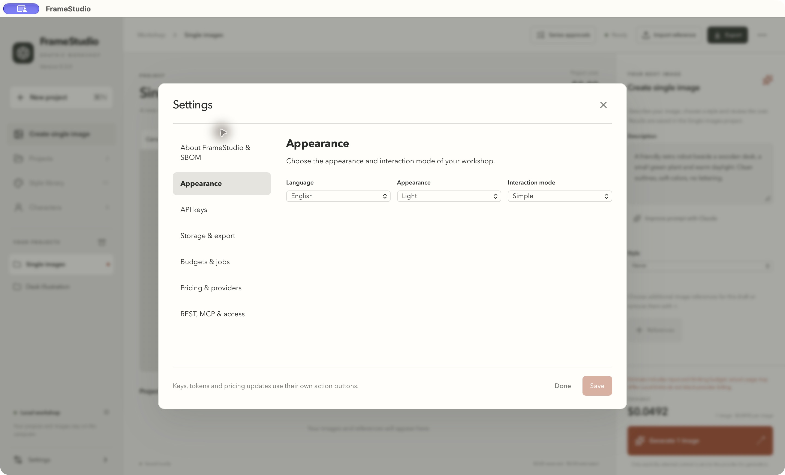
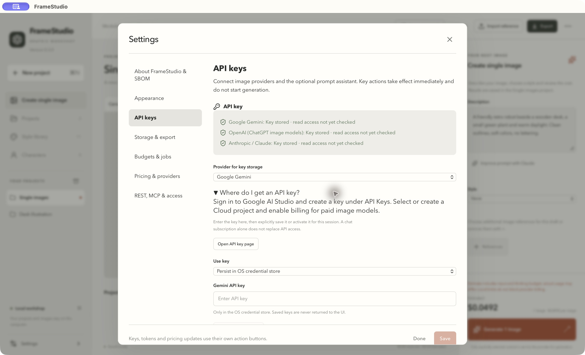
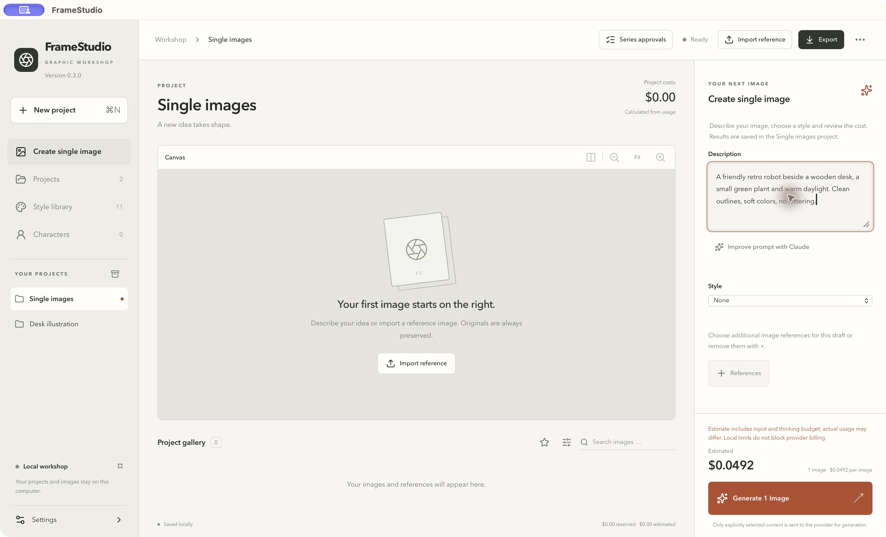
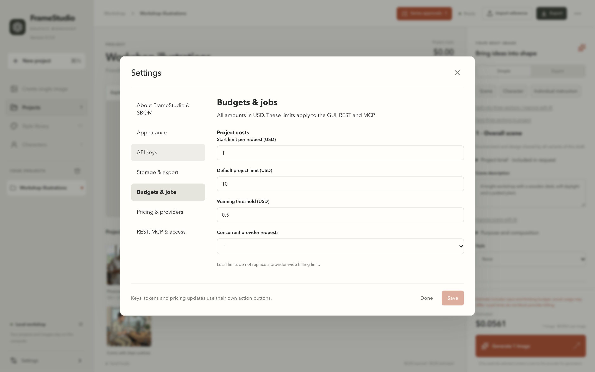
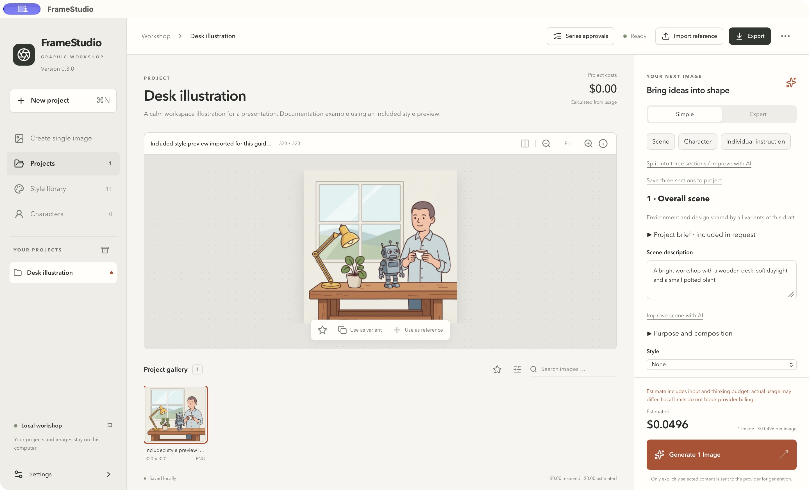
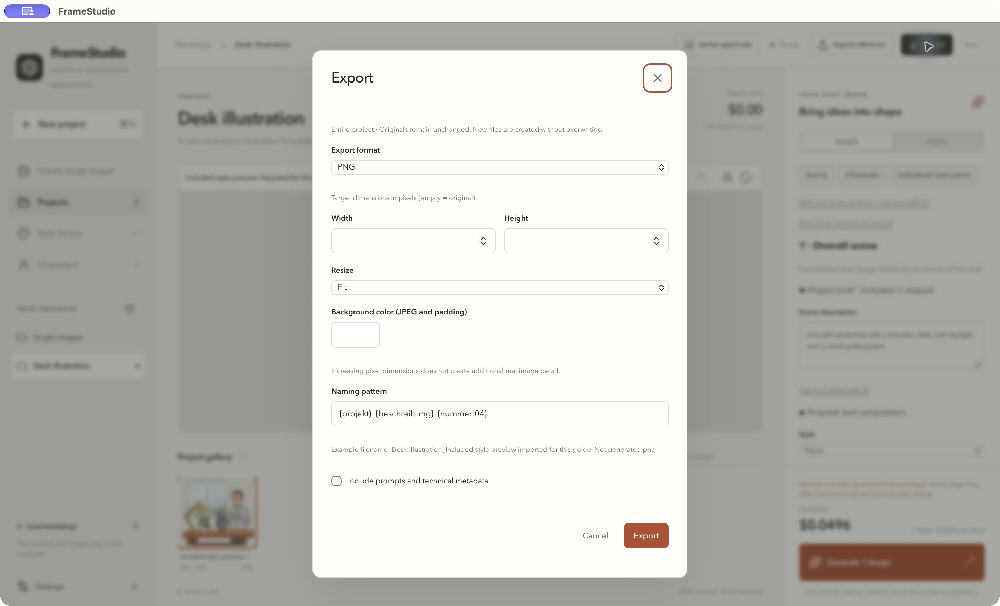

# FrameStudio Quickstart

*Deutsch: [de/QUICKSTART.md](de/QUICKSTART.md)*

Create your first image, review its cost and export it. This guide uses **FrameStudio 0.3.0** with the English interface. The screenshots show macOS; the steps are the same on Windows.

The screenshots are from the real desktop application in a separate example workspace. The desk illustration is an **included style preview imported for documentation**, not the result of a generation performed for this guide. No paid requests were made. Screenshot prices are examples, not current price guarantees. Click any screenshot to view it at full size.

## 1. Install and choose English

Download FrameStudio from the [release page](https://github.com/YorkStack/FrameStudio/releases/latest). On macOS, open the DMG and copy **FrameStudio** to **Applications**. On Windows, run the `-setup.exe`. This early release is neither Apple-notarized nor Authenticode-signed; see the [installation notes](../README.md#install) for how to open it the first time. Do not disable system security protections.

Open **Settings → Appearance**, set **Language** to **English**, then click **Save**. If the app starts in German, use **Einstellungen → Darstellung → Sprache → English → Speichern**. The language remains selected after restarting.

## 2. Connect an image provider

Open **Settings → API keys**. Choose **Google Gemini** or **OpenAI** under **Provider for key storage**. Expand **Where do I get an API key?** and use **Open API key page** if you need a key. A provider API account and any required billing must be ready before generating.

Choose how to use the key:

- **Persist in OS credential store:** enter the key and click **Save key securely**.
- **This session only · do not save:** enter the key and click **Use for this session**. The key is discarded when the app fully quits.

Scroll within the settings content if the key action buttons are below the visible area. **Typing a key or clicking the general Save button does not activate it.** Use the specific key button and check the resulting status. **Check key access** tests local access only; it does not verify provider billing or start a paid request.

Claude is optional and helps write prompts. It does not generate images.

*The screenshot shows stored-key status from the test machine. The download does not contain those keys, and a new installation will show its own status.*

## 3. Describe one image

Click **Create single image** at the top of the sidebar. In **Description**, try:

> A friendly retro robot beside a wooden desk, a small green plant and warm daylight. Clean outlines, soft colors, no lettering.

Choose a **Style**, or leave it at **None**. Choose an **Aspect ratio** and configured **Provider**; scroll inside the right panel to reach those controls. This entry always creates one image. Results are saved in the **Single images** project.

For a photo-based image, click **Import reference**, select a local image, then use **References** in the generator to select it for this request. Importing a file into the gallery alone does not mean it is sent to the provider.

## 4. Review and generate

Expand **Combined prompt** to check what will be sent. Review the estimate above **Generate 1 Image**. Set your limits under **Settings → Budgets & jobs** if needed, then click **Generate 1 Image** once.

The job indicator shows queued or running work. Series progress counts completed images; it is not a fabricated percentage for a provider request. If a job fails, open its details and read the error before starting another paid attempt.

Local budget limits help control starts in FrameStudio; they do not replace billing limits at the provider.

## 5. Inspect the result

When generation completes, select the result in the project gallery. Use **Fit**, zoom controls and **Image details** to inspect it. **Use as variant** prepares a related new image; **Use as reference** selects it for another request. Neither action silently regenerates the original.

The screenshot below shows where the gallery, image controls and **Export** button are located, using the bundled example illustration.

## 6. Export

Select the image using its gallery selection control, then click **Export selection**. Choose **PNG** for a simple first export. Leave dimensions empty to preserve the original size. Keep **Include prompts and technical metadata** off for a simple shareable image, then click **Export**. Use **Show in file manager** when the export is ready.

To export the whole project, clear the selection and click the top **Export** button. The dialog should say **Entire project**, as in the screenshot. To export a generated series without reference photos, open **Series approvals**, locate the series and click **Export series**. This includes all saved results from that series, even across gallery pages.

**Next:** read the [English User Guide](USER-GUIDE.md) for reusable prompts, characters, series approvals, backup, workspace changes, tokens and troubleshooting.
