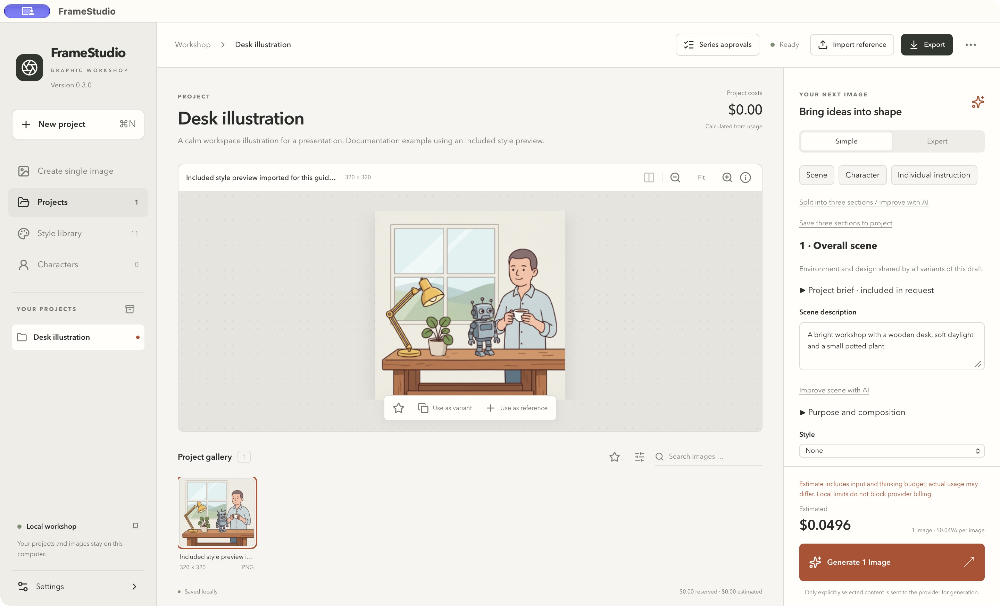
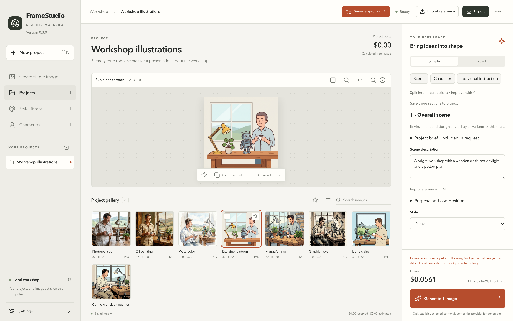
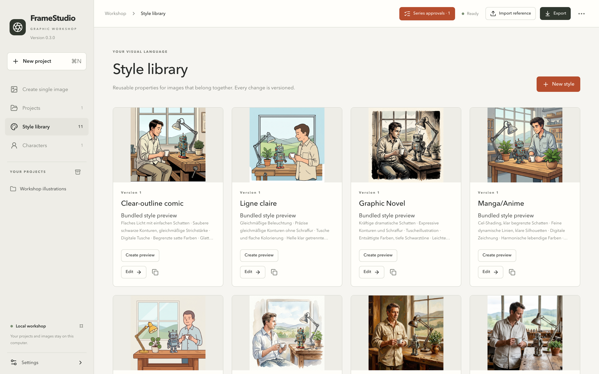
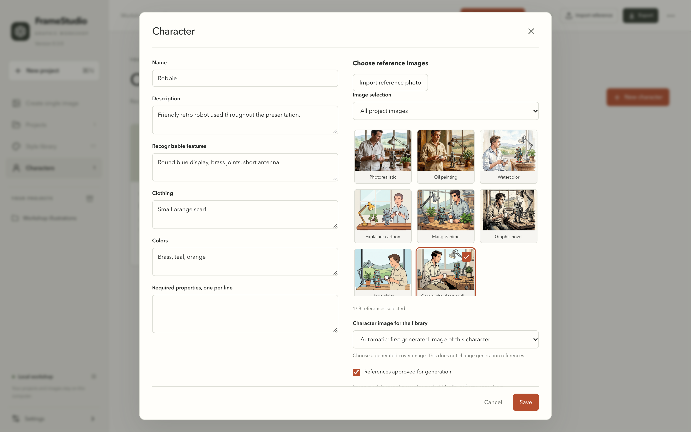
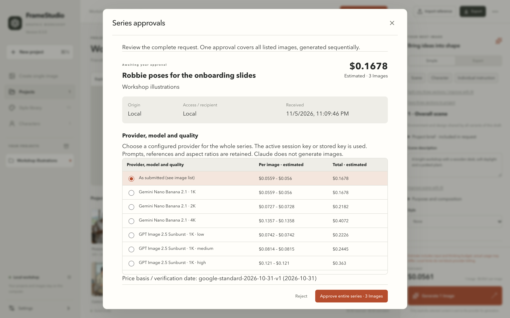
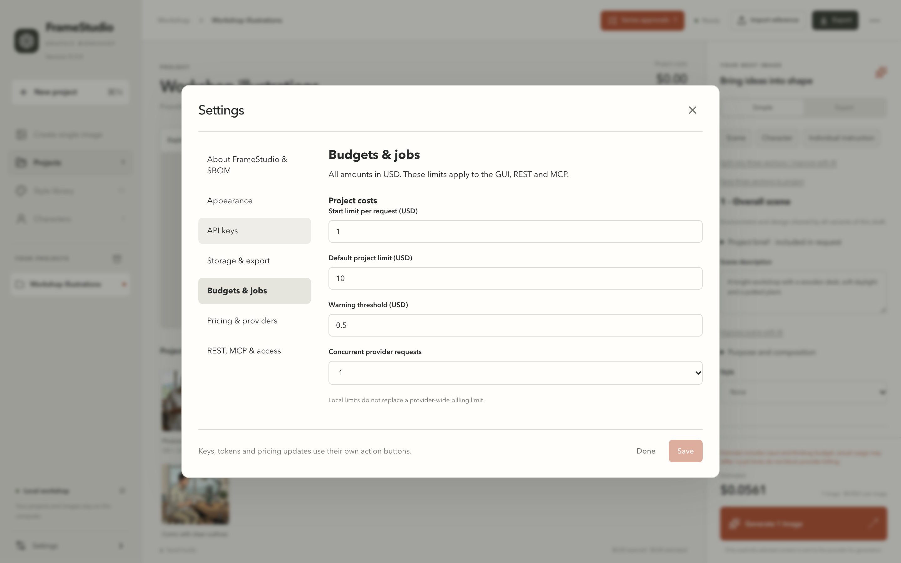
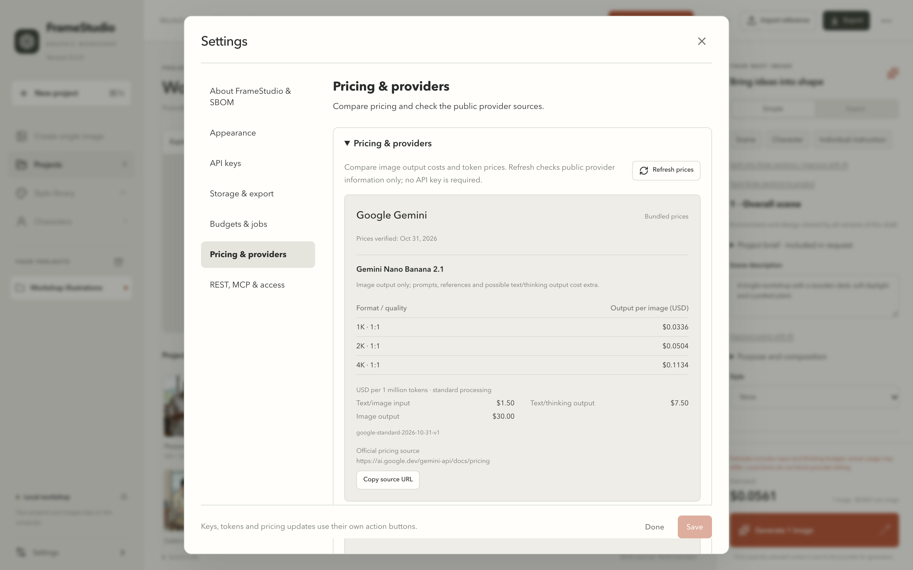
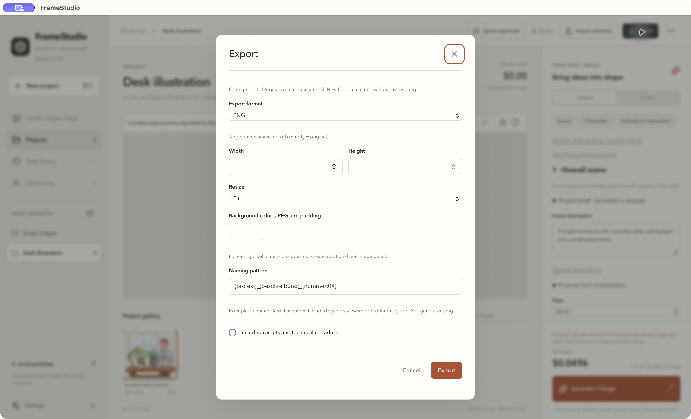
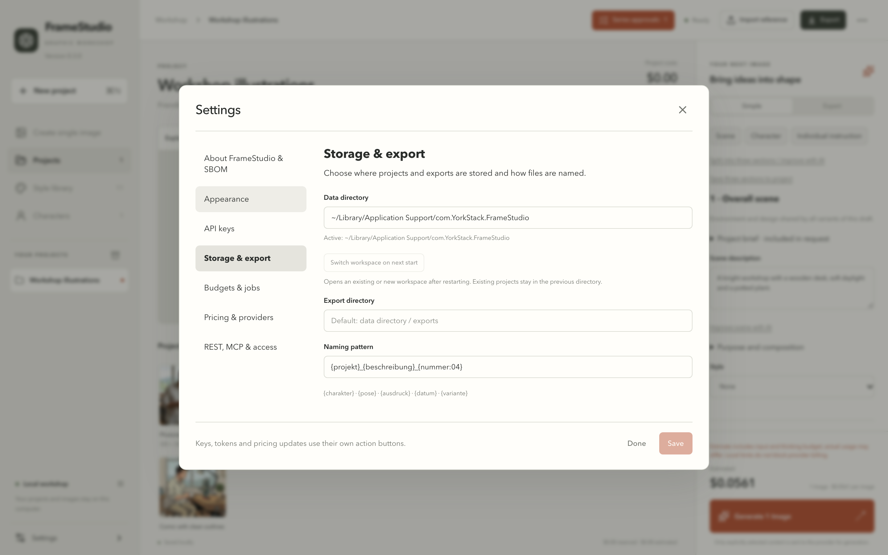
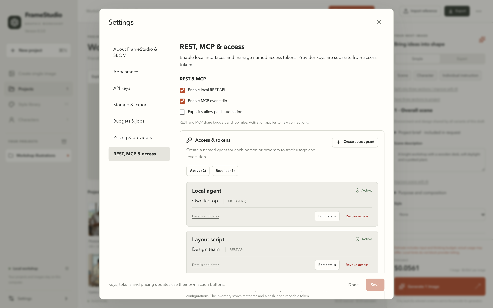

# FrameStudio User Guide

*Deutsch: [de/USER-GUIDE.md](de/USER-GUIDE.md)*

FrameStudio is a local image workshop for presentations, documents and character assets. Projects, original images and job history stay in your workspace. Image generation uses an explicitly selected external provider and your own API key.

This guide covers **version 0.3.0** for macOS and Windows. Screenshots and menu paths were captured on macOS; see [Windows notes](WINDOWS.md) for platform differences. Start with the illustrated [Quickstart](QUICKSTART.md) if you want to create one image first.

## Find your way around

| Area | Use it for |
|---|---|
| Create single image | A short description, style, optional references and one image |
| Projects | Reusable scene and character definitions, galleries and related work |
| Style library | Edit style templates, view included previews or generate your own |
| Characters | Save identity, clothing, colors, references and a display image |
| Series approvals | Review an automated request, choose a compatible model and approve its exact image list once |
| Settings | Language, keys, directories, budgets, pricing, local integrations and SBOM |

The project workspace has navigation on the left, a large image and gallery in the center, and the generator on the right. The top bar provides reference import, export, job status and project actions. In long panels or dialogs, scroll inside the content area; generation and dialog actions have a separate footer.

## Language and appearance

Use **Settings → Appearance** to choose English or German, Light/Dark/System appearance and Simple/Expert interaction mode. Click **Save** to apply ordinary settings. API keys, access tokens, workspace switching and pricing updates have their own action buttons.

The interface language does not translate your project titles, descriptions or historical prompts. In 0.3.0, editable built-in style prompt text and assembled prompt section labels can also remain German. You can edit prompt content independently; changing the interface language does not rewrite it.

## Connect providers and keep keys safe

Under **Settings → API keys**, choose a provider and expand **Where do I get an API key?**. The help opens that provider's official key page. Gemini and OpenAI are image providers; Anthropic Claude is the optional text prompt assistant. A chat subscription is separate from API billing.

**Persistent key:** select **Persist in OS credential store**, enter the key and click **Save key securely**. On macOS this uses Keychain, on Windows the Credential Manager. The app does not return stored secrets to the interface.

**Session key:** select **This session only · do not save**, enter the key and click **Use for this session**. Wait for the active-session status. This key takes priority over a stored key for the same provider. Closing Settings keeps it active; fully quitting the app discards it. **Remove session key** removes the memory-only key without deleting the stored one.

A stored-key indicator means an entry exists; it does not necessarily mean the current app can read it. **Check key access** tests local access. **Check keychain only** checks the stored entry even while a session key is active. Neither check validates the provider account, quota or credits.

Never put keys in project descriptions, prompts, screenshots, bug reports or source control.

## Create and organize projects

Click **New project** or press **Command+N** (Windows: **Ctrl+N**). Give it a recognizable name and a concise brief. The project can save a standard style, aspect ratio and output preferences. Open a project from **Projects** or its sidebar entry.

Use the top-right **Project actions** menu (three dots) for **Project defaults**, duplication, archiving and project backup. Archiving retains the project and its images. **Show archive** in the sidebar opens archived projects; open an archived project and use **Restore** in its actions menu to make it active again.

To remove a project from the main gallery, use **Delete project** on its project card and confirm moving it to the trash. This is recoverable: **Trash** in the project overview lets you restore it. Images, job history and costs remain retained in the local trash; this action is not permanent disk cleanup.

## Build prompts in three sections

A project generator separates the reusable content from the instruction for one image:

| Section | Example |
|---|---|
| Scene | A bright workshop, wooden desk, soft daylight and a potted plant |
| Character | A friendly retro robot with brass joints and a round blue display |
| Individual instruction | Show the robot waving with its right hand, facing the viewer |

Use the section buttons to jump to each area. **Save three sections to project** stores the reusable draft. Inspect **Combined prompt** before sending: the project brief, style, character definition, references and individual instruction are combined into one request. Each submitted job keeps its historical snapshot; editing a template later does not rewrite that job.

Expert mode exposes model-specific settings and further prompt controls. Only use parameters offered for the chosen model. Aspect ratios, native resolution and output formats vary by provider/model. Export resizing is separate from native generation resolution.

### Improve prompts with Claude

Configure the Anthropic key first. Use **Improve scene with AI**, **Improve character text with AI** or **Improve prompt with Claude** for the corresponding section. **Split into three sections / improve with AI** handles all three together. Review the assistant's cost estimate and proposed text before applying changes. Text-assistant requests may cost money; image generation is a separate action and charge.

Claude produces text suggestions, not images. Manual editing remains available without an assistant key.

## Import and remove references

**Import reference** adds an image to the current project. In the generator, use **References** or an image's **Use as reference** action to select it for the current draft. Only selected content is submitted for generation.

Remove a selected reference with its **×** control. This removes it from the draft, not from the gallery. A saved character has its own reference selection and approval; edit the character to remove those references. Removing a gallery asset is a separate action in its details and does not rewrite earlier job snapshots.

Do not assume that an image visible in the large preview is automatically a generation reference. Check the draft's reference selection before starting.

## Styles and preview images

Open **Style library** to browse editable templates. Included neutral previews are available without a paid request. A style describes medium, lines, palette, lighting and texture; its thumbnail is an illustration of those properties, not an automatic reference sent with every image.

Use **Edit** to change a style or **Duplicate** to create your own version. **Create preview** opens a generation draft. Review provider and cost, generate, then choose **Use as style preview** for the result you want displayed in the library. Existing previews do not need to be regenerated just to use the style.

## Characters and series

Create a character from **Characters** or **New character** in the generator. Record recognizable features, clothing and colors. Select reference images and explicitly approve them for generation when appropriate. Choose the intended generated character image for its display preview; the display image and generation references serve different purposes.

Use **Plan character set** to prepare views, poses, expressions and mouth shapes. Review the actual list and total count before starting; avoid accidentally generating every possible combination. Models can vary a character's identity between images even when the same references are used.

### Approve a REST or MCP series once

Open **Series approvals**. Check the description, originating interface, access recipient, destination project, exact planned images and total estimated cost. Where compatible choices are available, select the configured provider/model and review the recalculated estimate. Selecting a provider uses its active session key or stored key; it does not expose the key value.

If the series exceeds the normal per-request start limit, the dialog may offer an explicit one-time limit for that series. The project budget still applies. Approve the whole series once: each listed image becomes a persistent job and is processed with the configured concurrency. A later series or a changed plan needs its own approval.

For session keys, the same running app must process the work. After restarting, activate the key again; do not blindly create a duplicate series. Inspect the existing jobs first.

## Jobs, errors and costs

The job area shows queued, running and completed work, errors and available cancellation. A series progress bar counts completed items. The provider may not supply progress within an individual image request; the app must not imply that it does.

| Cost label | Meaning |
|---|---|
| Estimated | Forecast based on the selected model, inputs and stored price table |
| Calculated from usage | Computed from provider usage fields and the job's price basis |
| Provider-confirmed amount | An amount explicitly supplied by the provider |
| Unknown | A reliable actual amount is unavailable; it is not zero |

Set warnings, start limits, project budgets and concurrency under **Settings → Budgets & jobs**. View dated prices and request supported price updates under **Pricing & providers**. Historical jobs keep their price basis. Local limits do not cap charges made by other apps or enforce a global provider billing limit.

USD estimates are not a tax-inclusive EUR invoice. Provider billing may include currency conversion, taxes, other requests and reporting delay. Compare the same provider, time window and usage before comparing amounts.

Cancellation is best effort after a provider request has been sent. An unclear timeout result can still incur a charge. Inspect the error/status before deliberately retrying; a retry is another request.

## Export an image, a selection or a whole series

**One image or selected images:** use the selection controls on gallery cards, then **Export selection**. Clicking an image to inspect it is different from selecting it for export. **Select visible** applies to the visible gallery page.

**Whole project:** clear the selection, then click the top **Export** button. Verify that the dialog says **Entire project**. This can include imported references.

**Whole generated series:** open **Series approvals**, locate the series and click **Export series**. All currently saved results from that series are gathered in order, including results on other gallery pages. References and other series are excluded. Wait until the series finishes if you want every planned result in one export.

| Format | Useful for |
|---|---|
| Original files | Preserve provider/import file bytes |
| PNG | Lossless sharing; preserves existing transparency |
| JPEG | Compact opaque images; explicitly choose the background color |
| WebP or TIFF | Supported web or image-production workflows |
| Offline HTML gallery | Browse a selection without a server |
| PDF | One image per page or a contact sheet |
| PowerPoint / PPTX | One image per slide or contact layout; text remains editable |
| Sprite-Sheet + JSON | Fixed cells, padding, order and a metadata manifest |
| ZIP project package | Transfer or restore a project with a versioned manifest |

Leave target dimensions empty for original resolution. Choose fitting, cropping or padding deliberately; cropping can remove parts of a figure. Enlarging an image does not create new native detail. PNG preserves transparency that already exists; conversion alone does not remove a background.

Review document titles, captions, page/slide layout and sprite cell settings when those options appear. Keep **Include prompts and technical metadata** off for sharing when you do not want those details included. Keys and access tokens are never part of project exports.

Click **Export**, wait for completion, then use **Show in file manager**. Original assets are preserved and exports do not overwrite them.

## Back up, restore and change the workspace

Use **Project actions → Back up project** or choose **ZIP project package** in Export. For a full project backup, clear any gallery selection first and include the metadata you want to retain. Keep backups outside the working folder if you need a separate recovery copy.

Use **Import project ZIP** to restore a package as another project. Restoration does not overwrite an existing project.

In **Settings → Storage & export**, choose an empty directory or an existing FrameStudio workspace. Apply the dedicated workspace-change action and restart. This changes the active data location; it does not move or delete the previous workspace. Export/import project ZIPs to transfer projects between workspaces. The export directory is a separate preference.

## REST and MCP access

These interfaces are optional and disabled by default. Open **Settings → REST, MCP & access** to enable the interface you need. REST is local loopback; MCP uses stdio. Both share the GUI's projects, budgets and job rules.

Create a separate access token for each program or person. Record its recipient and purpose. Copy the token when first shown and store it in the client securely; it cannot later be displayed again. Provider keys and local access tokens are different credentials.

The compact list shows active entries by default. Expand an entry for details and use its revoke action to invalidate that token. The revoked view is history: a token marked **Revoked** is already invalid and cannot be revoked a second time. Revoking a client token does not cancel a previously approved generation job; manage jobs separately.

For commands, scopes, headless operation and client examples, see [API and MCP setup](API.md) and [operation contracts](CONTRACT.md). A hosted model cannot directly reach your Mac's localhost or stdio; a local client must bridge that connection.

## Troubleshooting

| Symptom | What to check |
|---|---|
| Generate is disabled | Enter an instruction, select an available provider and wait for a valid estimate; check displayed validation messages |
| Key entered but not active | Click **Use for this session** or **Save key securely**, not only the general settings Save button |
| Keychain access denied | Open macOS **Keychain Access**, not Passwords; inspect the FrameStudio entry and permission for the current app. An unlocked keychain can still deny app access after a rebuild. Use a session key while resolving it; do not reset the keychain or grant all apps access |
| Provider rejects the request | Read the detailed job error; check model access, supported parameters, billing, credits and quota. Local key-access checks do not verify these |
| Series seems stuck | Check job counts/status, the selected provider's key and the existing approval. Reactivate a session key after a full restart |
| Export misses images | Check selected vs visible vs whole-project scope. Use **Export series** for all saved results of a particular series |
| Project missing after folder change | The new workspace is separate; switch back or import a project ZIP |
| Unexpected German text in English mode | Project/style prompt content and some assembled-prompt labels are data retained by version 0.3.0; edit them independently if needed |

For a bug report, include the app version, operating system and version, steps and error code. Exclude keys, access tokens and private prompts/photos. **Settings → About FrameStudio & SBOM → Export SBOM as JSON** provides the dependency inventory; it is not a vulnerability verdict.

## Scope of this release

The published binaries target Apple Silicon macOS and Windows x64. The macOS app is not Apple Developer ID signed or notarized, and the Windows installer has no Authenticode signature. This release produces images and character assets, not video, audio or automatic lip sync. Included screenshots use a separate example project and bundled sample artwork; they do not expose personal projects or perform paid generations.
