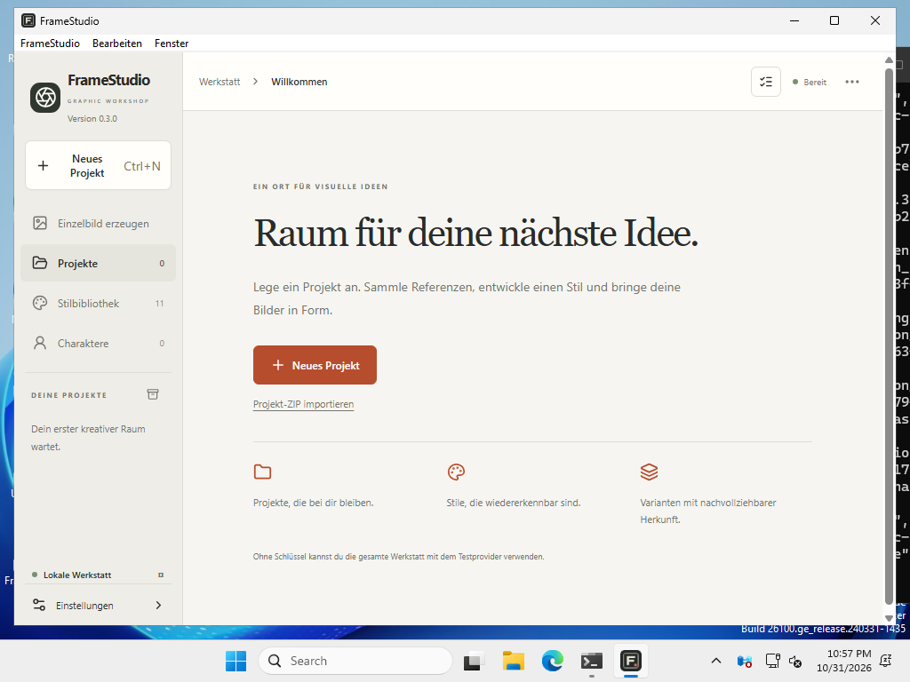

# Windows x64 build and installation

*Deutsch: [de/WINDOWS.md](de/WINDOWS.md)*

FrameStudio uses the same Rust core and React interface on Windows and macOS.
The Windows package is an NSIS installer for Intel/AMD 64-bit Windows. ARM64-native and 32-bit packages are not included.

## Install

Download the Windows `-setup.exe` from the GitHub release, run it, and choose English or German. Installation is per-user and normally needs no administrator rights. If Microsoft WebView2 is missing, the installer downloads and installs it; an internet connection is required for that step. No Node.js, Rust, Python, Docker or database server is needed to use FrameStudio.

This early Windows package has no Authenticode publisher signature, so Windows SmartScreen may show a warning. Choose **More info → Run anyway** if you trust the download (compare it with `WINDOWS-SHA256SUMS` from the release). An organization's security policy may block it entirely. Do not disable system protections; managed installations should be reviewed by the administrator.

Open **Settings → API keys** and add your own provider key. Persistent keys use the Windows credential store. Session keys exist only in the running process. The macOS Keychain is not used on Windows. Select a local workspace in **Settings → Storage & export**; its contents are not moved automatically when switching folders.

The English [Quickstart](QUICKSTART.md) and [User Guide](USER-GUIDE.md) also describe Windows workflows; their screenshots were captured on macOS.

## Reproduce the build

On Windows, install the pinned Node/npm/Rust versions listed in [CONTRIBUTING.md](../CONTRIBUTING.md), Python 3.11 or later, and the Visual Studio C++ build tools and Windows SDK required by Tauri. Then run:

```powershell
npm ci
npm run build
cargo test --manifest-path src-tauri/Cargo.toml --locked --no-default-features
cargo clippy --manifest-path src-tauri/Cargo.toml --locked --all-targets -- -D warnings
npm run tauri -- build --bundles nsis -- --locked
```

`src-tauri/tauri.windows.conf.json` is automatically merged on Windows. Output: `src-tauri/target/release/bundle/nsis/FrameStudio_0.3.0_x64-setup.exe`.

The manually dispatched [Windows installer workflow](../.github/workflows/windows-release.yml) runs the tests, a synthetic native credential write/read/replace/delete test, Clippy, dependency audit, packaging, silent installation, installed-executable REST/export/restart acceptance, and a native-window startup smoke test. It uploads the installer and evidence for review; it does not automatically publish a release.

A startup smoke test is not a complete interactive Windows GUI acceptance. No paid provider requests are made by this workflow. Existing cross-platform tests cover actual REST and MCP connections; the installed release executable is additionally checked through REST.

Packaging follows the official [Tauri Windows installer documentation](https://v2.tauri.app/distribute/windows-installer/), checked on 2026-10-31. No new runtime dependency, database migration, Tauri permission or CSP relaxation is required by the Windows packaging configuration.

## Windows validation — 2026-10-31

The x64 package is built from [7871eb654ba2ee6aafe74a2fb94ca518f7846b1b](https://github.com/YorkStack/FrameStudio/commit/7871eb654ba2ee6aafe74a2fb94ca518f7846b1b), after the original macOS 0.3.0 tag. The tag and macOS binaries are unchanged. Use this exact commit to reproduce the Windows artifact.

Environment: GitHub-hosted Windows Server 2025 x64 (`windows-2025-vs2026` image), MSVC toolchain, Rust 1.98.1, Node 24.22.1 and npm 12.2.1. [Build logs and evidence](https://github.com/YorkStack/FrameStudio/actions/runs/41249852482).

| Check | Result |
|---|---|
| Core and integration tests | 128 passed, 3 initially ignored; includes actual REST and official-SDK MCP connections |
| Native Windows credential store | Additional explicit synthetic write/read/replace/delete test passed |
| Rust formatting, Clippy, production frontend | Passed |
| npm audit | No known vulnerabilities reported at check time |
| NSIS installer | Built, silently installed and installed executable version checked |
| Installed-app REST acceptance | Project, style, reference, character and 3 test variants; idempotency and restart persistence passed |
| Exports | Original, PNG, JPEG, WebP, TIFF, HTML, PDF, PPTX, sprite sheet and project ZIP exported and read; ZIP restored |
| Native desktop | Window visible and responding; outer bounds fit the monitor working area including taskbar and decorations |
| Small-window layout | Two targeted Playwright tests passed locally; native Windows screenshot checked separately |

No provider secrets or paid requests are used in these checks. The credential test creates and removes isolated synthetic entries. Export tests check file contents and project ZIP restoration; PDF/PPTX rendering in Windows desktop viewers was not performed. A complete manual Windows 10/11 interaction test and real paid image generation on Windows remain open. Windows ARM64-native and x86 builds are not provided.

Windows-specific fixes include supported native menu actions, Ctrl+N shortcut labeling, a scrollable compact sidebar, reachable dialog actions, and an initial window constrained to the monitor working area. Runtime dependencies, permissions, CSP and database schema are unchanged.

Native screenshot from the installed Windows build (1024 × 768 CI desktop):



The installed headless executable became REST-ready in 290.35 ms in this single CI sample. This is not native GUI startup time or a consumer-hardware benchmark. No Windows total-memory benchmark was captured.
