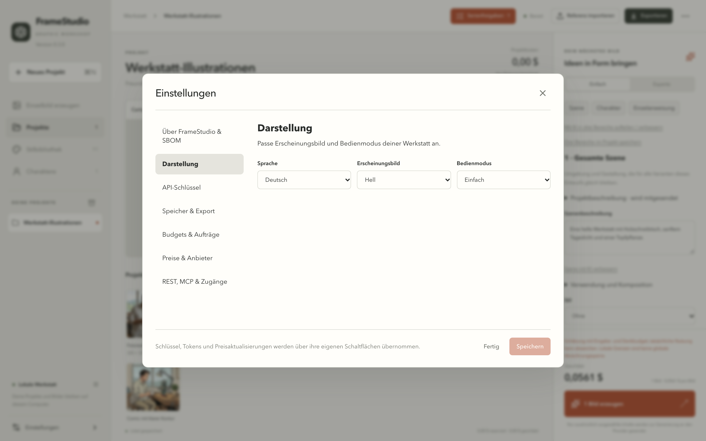
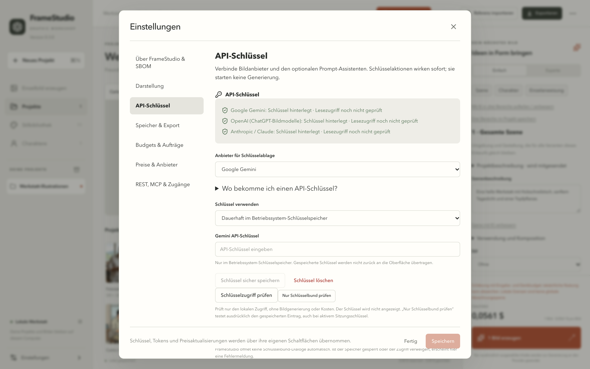
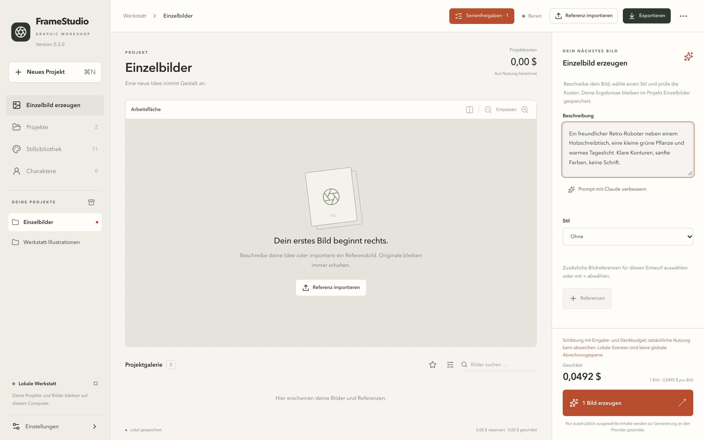
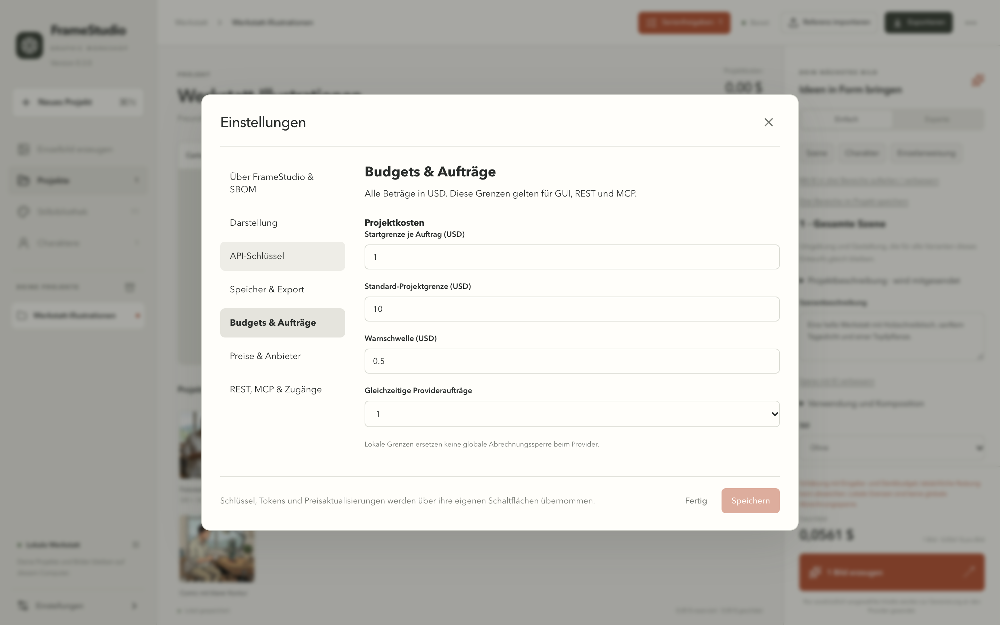
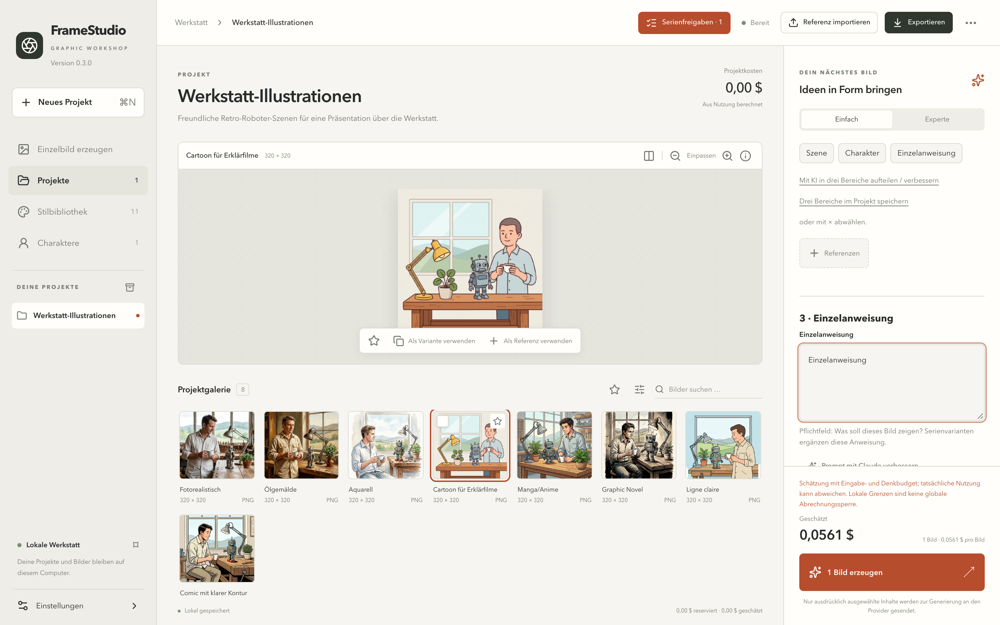
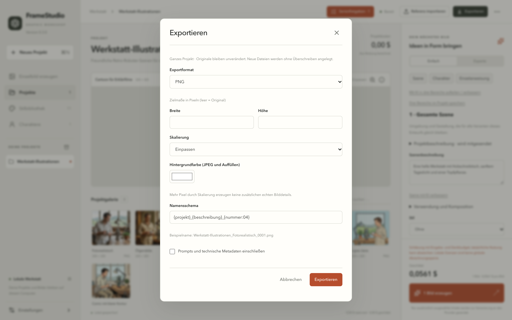

# FrameStudio – Schnellstart

*English: [../QUICKSTART.md](../QUICKSTART.md)*

Erstes Bild erzeugen, Kosten prüfen und exportieren. Diese Anleitung beschreibt **FrameStudio 0.3.0** mit deutscher Oberfläche. Die Screenshots stammen von macOS; unter Windows sind die Schritte gleich.

Die Screenshots entstehen aus einem separaten Beispiel-Arbeitsbereich mit dem kostenlosen Testprovider und den mitgelieferten Stilvorschauen. Es wurden keine kostenpflichtigen Anfragen gestellt. Preise in Screenshots sind Beispiele, keine Preiszusage.

## 1. Installieren und Sprache wählen

FrameStudio von der [Release-Seite](https://github.com/YorkStack/FrameStudio/releases/latest) herunterladen. Unter macOS die DMG öffnen und **FrameStudio** nach **Programme** ziehen. Unter Windows die `-setup.exe` ausführen. Diese frühe Version ist weder von Apple notarisiert noch mit Authenticode signiert; wie man sie beim ersten Start öffnet, steht in der [Installationsanleitung](README.md#installieren). Keine Systemschutzfunktionen abschalten.

Die App startet auf Deutsch. Unter **Einstellungen → Darstellung → Sprache** lässt sich Englisch wählen; danach **Speichern** klicken. Die Auswahl bleibt nach einem Neustart erhalten.

## 2. Bildanbieter verbinden

**Einstellungen → API-Schlüssel** öffnen. Unter **Anbieter für Schlüsselablage** **Google Gemini** oder **OpenAI** wählen. **Wo bekomme ich einen API-Schlüssel?** aufklappen und bei Bedarf **Schlüsselseite öffnen** verwenden. Ein API-Konto beim Anbieter und gegebenenfalls die Abrechnung müssen vor dem Erzeugen eingerichtet sein.

Wählen, wie der Schlüssel verwendet wird:

- **Dauerhaft im Betriebssystem-Schlüsselspeicher:** Schlüssel eingeben und **Schlüssel sicher speichern** klicken.
- **Nur für diese Sitzung · nicht speichern:** Schlüssel eingeben und **Für diese Sitzung verwenden** klicken. Der Schlüssel verschwindet, wenn die App vollständig beendet wird.

Liegen die Schaltflächen unterhalb des sichtbaren Bereichs, innerhalb der Einstellungen scrollen. **Das Eintippen eines Schlüssels oder das allgemeine Speichern aktiviert ihn nicht.** Die eigene Schlüssel-Schaltfläche verwenden und den angezeigten Status prüfen. **Schlüsselzugriff prüfen** testet nur den lokalen Zugriff; Abrechnung beim Anbieter wird nicht geprüft und es entstehen keine Kosten.

Claude ist optional und hilft beim Formulieren von Prompts. Claude erzeugt keine Bilder.

## 3. Ein Bild beschreiben

Oben in der Seitenleiste **Einzelbild erzeugen** klicken. Unter **Beschreibung** zum Beispiel eingeben:

> Ein freundlicher Retro-Roboter neben einem Holzschreibtisch, eine kleine grüne Pflanze und warmes Tageslicht. Klare Konturen, sanfte Farben, keine Schrift.

Einen **Stil** wählen oder **Ohne** lassen. **Seitenverhältnis** und einen eingerichteten **Provider** wählen; dazu im rechten Bereich scrollen. Dieser Einstieg erzeugt immer genau ein Bild. Ergebnisse landen im Projekt **Einzelbilder**.

Für ein Bild auf Basis eines Fotos **Referenz importieren** klicken, ein lokales Bild wählen und es dann im Generator unter **Referenzen** für diesen Auftrag auswählen. Ein Bild nur in die Galerie zu importieren bedeutet nicht, dass es an den Anbieter geschickt wird.

## 4. Prüfen und erzeugen

**Zusammengesetzter Prompt** aufklappen, um zu sehen, was gesendet wird. Die Kostenschätzung über der Schaltfläche **1 Bild erzeugen** prüfen. Grenzen bei Bedarf unter **Einstellungen → Budgets & Aufträge** festlegen, dann einmal **1 Bild erzeugen** klicken.

Die Auftragsanzeige zeigt wartende und laufende Arbeit. Der Fortschritt einer Serie zählt fertige Bilder; für eine einzelne Anfrage beim Anbieter wird kein ausgedachter Prozentwert angezeigt. Schlägt ein Auftrag fehl, die Details öffnen und den Fehler lesen, bevor ein weiterer kostenpflichtiger Versuch startet.

Lokale Budgetgrenzen begrenzen Starts in FrameStudio; sie ersetzen keine Abrechnungsgrenzen beim Anbieter.

## 5. Ergebnis ansehen

Nach Abschluss das Ergebnis in der Projektgalerie auswählen. Mit **Einpassen**, den Zoom-Schaltflächen und **Bilddetails** lässt es sich genauer ansehen. **Als Variante verwenden** bereitet ein verwandtes neues Bild vor; **Als Referenz verwenden** wählt es für einen weiteren Auftrag aus. Keine der beiden Aktionen erzeugt das Original heimlich neu.

## 6. Exportieren

Das Bild über das Auswahlfeld auf seiner Galeriekarte auswählen und **Auswahl exportieren** klicken. Für den ersten Export **PNG** wählen. Abmessungen leer lassen, damit die Originalgröße erhalten bleibt. **Prompts und technische Metadaten einschließen** für ein einfach teilbares Bild ausgeschaltet lassen, dann **Exportieren** klicken. Ist der Export fertig, **Im Dateimanager anzeigen** verwenden.

Für das ganze Projekt die Auswahl aufheben und oben auf **Exportieren** klicken. Der Dialog zeigt dann **Ganzes Projekt**, wie im Screenshot. Um eine erzeugte Serie ohne Referenzfotos zu exportieren, **Serienfreigaben** öffnen, die Serie suchen und **Serie exportieren** klicken. Das umfasst alle gespeicherten Ergebnisse dieser Serie, auch über mehrere Galerieseiten.

**Weiter:** Das [Benutzerhandbuch](USER-GUIDE.md) erklärt wiederverwendbare Prompts, Charaktere, Serienfreigaben, Sicherung, Arbeitsbereichswechsel, Zugriffstokens und Fehlerbehebung.
