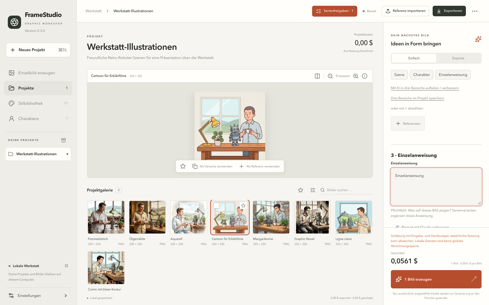

# FrameStudio – Dokumentation auf Deutsch

*English: [../../README.md](../../README.md)*

Eine lokale Bildwerkstatt für macOS und Windows. Bilder entstehen mit Google Gemini oder OpenAI und dem eigenen API-Schlüssel. Sie lassen sich in Projekten mit wiederverwendbaren Szenen und Figuren ordnen und als PNG, PDF, PowerPoint, Sprite-Sheet und mehr exportieren. Die Projekte bleiben auf dem eigenen Rechner. Die App startet auf Deutsch.

## Installieren

Die aktuelle Version von der **[Release-Seite](https://github.com/YorkStack/FrameStudio/releases/latest)** herunterladen. Docker, Datenbankserver, Node oder Rust werden nicht gebraucht.

### macOS (Apple Silicon)

1. `FrameStudio_<Version>_aarch64.dmg` öffnen und **FrameStudio** nach **Programme** ziehen.
2. FrameStudio starten. Weil diese frühe Version nur ad-hoc signiert und nicht notarisiert ist, meldet macOS unter Umständen, dass die App nicht überprüft werden kann.
3. Dann **Systemeinstellungen → Datenschutz & Sicherheit** öffnen, zum Hinweis zu FrameStudio scrollen und **Dennoch öffnen** klicken. Das ist pro Version einmal nötig. Gatekeeper und andere Schutzfunktionen nicht abschalten.

### Windows (x64)

1. `FrameStudio_<Version>_x64-setup.exe` ausführen. Der Installer pro Benutzer bietet Deutsch oder Englisch an und installiert bei Bedarf WebView2 (Internet nötig).
2. Der Installer ist noch nicht mit Authenticode signiert, deshalb kann Windows SmartScreen warnen. Wer dem Download vertraut, wählt **Weitere Informationen → Trotzdem ausführen**. Auf verwalteten Firmenrechnern kann die Installation gesperrt sein; dann die Administration fragen.

Details: [Windows-Installation und Testbericht](WINDOWS.md). Prüfsummen liegen jedem Release bei (`SHA256SUMS`).

## Das erste Bild

1. **Einstellungen → API-Schlüssel** öffnen, Google Gemini oder OpenAI wählen und mit **Schlüsselseite öffnen** beim Anbieter einen Schlüssel anlegen.
2. Schlüssel einfügen und **Schlüssel sicher speichern** (macOS-Schlüsselbund bzw. Windows-Anmeldeinformationsverwaltung) oder **Für diese Sitzung verwenden** (nur im Arbeitsspeicher) klicken.
3. In der Seitenleiste **Einzelbild erzeugen** klicken, das Bild beschreiben, die Kostenschätzung prüfen und erzeugen.
4. Das Ergebnis in der Galerie auswählen und **Auswahl exportieren** klicken.

Der bebilderte **[Schnellstart](QUICKSTART.md)** führt mit Screenshots durch diese Schritte.

## Schlüssel und Datenschutz

- API-Schlüssel liegen nur im Schlüsselspeicher des Betriebssystems oder im Arbeitsspeicher, nie im Klartext, in Projektdateien oder Exporten.
- Projekte, Bilder und Auftragsverlauf bleiben im lokalen Arbeitsbereich.
- Beim Erzeugen gehen nur der gewählte Prompt und die ausgewählten Referenzen an den gewählten Anbieter.
- Der Download enthält keine Entwickler-Schlüssel, Tokens, persönlichen Fotos oder Nutzerprojekte.

Schlüssel nie in ein Issue, einen Chat oder einen Screenshot einfügen. Sicherheitsprobleme bitte vertraulich melden, siehe [SECURITY.md](../../SECURITY.md).

## Alle Dokumente

| Für Anwender | Für Entwicklung und Anbindung |
|---|---|
| [Schnellstart](QUICKSTART.md) – erstes Bild in sechs Schritten | [REST und MCP](API.md) – Einrichtung und Beispiele |
| [Benutzerhandbuch](USER-GUIDE.md) – Projekte, Charaktere, Serien, Export, Fehlerbehebung | [Operationsvertrag](CONTRACT.md) und [OpenAPI](../openapi.json) |
| [Windows](WINDOWS.md) – Installation und Plattformhinweise | [Architektur und Sicherheitsmodell](ARCHITECTURE.md) · [Sicherheitsdesign](SECURITY-DESIGN.md) |
| [Schlüsselbund-Fehlerbehebung (macOS)](KEYCHAIN.md) | [Exporte und Projektpakete](EXPORTS.md) |
| | [Providerprüfung und Preise](PROVIDER-VERIFICATION.md) · [Abhängigkeiten](DEPENDENCIES.md) |

Der [Abnahmebericht zu 0.3.0](../RELEASE-0.3.0.md), [CONTRIBUTING](../../CONTRIBUTING.md) und das [CHANGELOG](../../CHANGELOG.md) gibt es nur auf Englisch.
