# FrameStudio – Benutzerhandbuch

*English: [../USER-GUIDE.md](../USER-GUIDE.md)*

FrameStudio ist eine lokale Bildwerkstatt für Präsentationen, Dokumente und Figuren. Projekte, Originalbilder und Auftragsverlauf bleiben im eigenen Arbeitsbereich. Bilder entstehen bei einem ausdrücklich gewählten externen Anbieter mit dem eigenen API-Schlüssel.

Dieses Handbuch beschreibt **Version 0.3.0** für macOS und Windows. Screenshots und Menüwege stammen von macOS; Unterschiede unter Windows stehen in den [Windows-Hinweisen](WINDOWS.md). Wer zuerst nur ein Bild erzeugen möchte, beginnt mit dem [Schnellstart](QUICKSTART.md).

## Orientierung

| Bereich | Wofür |
|---|---|
| Einzelbild erzeugen | Kurze Beschreibung, Stil, optionale Referenzen und genau ein Bild |
| Projekte | Wiederverwendbare Szenen- und Charakterdefinitionen, Galerien und zusammengehörige Arbeit |
| Stilbibliothek | Stilvorlagen bearbeiten, mitgelieferte Vorschauen ansehen oder eigene erzeugen |
| Charaktere | Merkmale, Kleidung, Farben, Referenzen und ein Anzeigebild speichern |
| Serienfreigaben | Automatisierten Auftrag prüfen, passendes Modell wählen und die genaue Bildliste einmal freigeben |
| Einstellungen | Sprache, Schlüssel, Verzeichnisse, Budgets, Preise, lokale Schnittstellen und SBOM |

Im Projektarbeitsbereich liegt links die Navigation, in der Mitte das große Bild mit Galerie und rechts der Generator. Die obere Leiste enthält Referenzimport, Export, Auftragsstatus und Projektaktionen. In langen Bereichen oder Dialogen innerhalb des Inhalts scrollen; Erzeugen- und Dialog-Schaltflächen haben eine eigene Fußzeile.

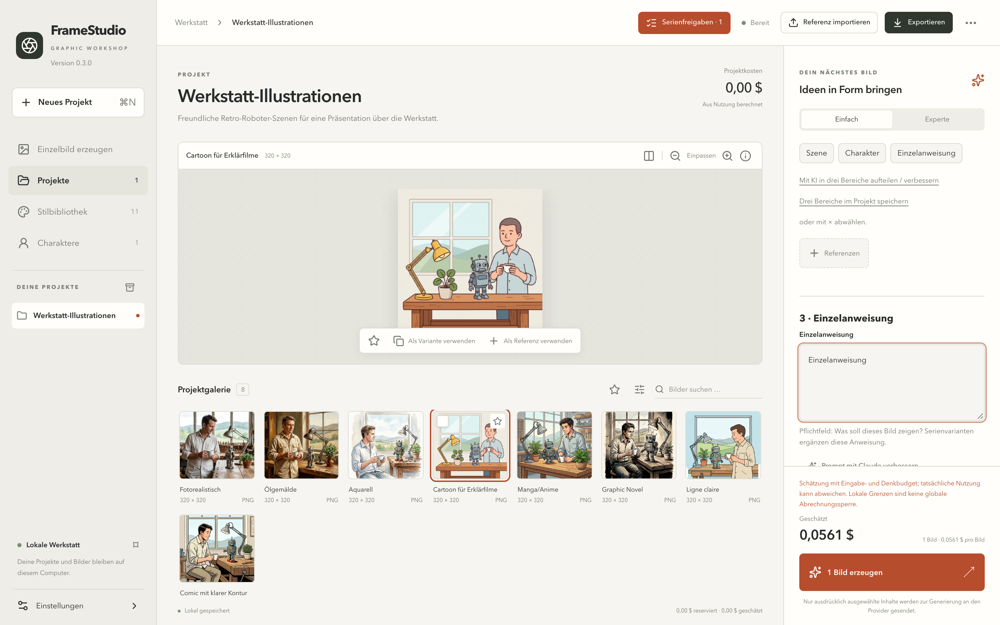

## Sprache und Darstellung

Unter **Einstellungen → Darstellung** lassen sich Deutsch oder Englisch, helles/dunkles/systemabhängiges Erscheinungsbild und der Bedienmodus Einfach/Experte wählen. Mit **Speichern** werden diese Einstellungen übernommen. API-Schlüssel, Zugriffstokens, Arbeitsbereichswechsel und Preisaktualisierungen haben eigene Schaltflächen.

Die Oberflächensprache übersetzt keine Projekttitel, Beschreibungen oder gespeicherten Prompts. Eigene Inhalte bleiben in der Sprache, in der sie geschrieben wurden.

## Anbieter verbinden und Schlüssel schützen

Unter **Einstellungen → API-Schlüssel** einen Anbieter wählen und **Wo bekomme ich einen API-Schlüssel?** aufklappen. Die Hilfe öffnet die offizielle Schlüsselseite des Anbieters. Gemini und OpenAI erzeugen Bilder; Anthropic Claude ist der optionale Text-Assistent für Prompts. Ein Chat-Abonnement ist von der API-Abrechnung getrennt.

**Dauerhafter Schlüssel:** **Dauerhaft im Betriebssystem-Schlüsselspeicher** wählen, Schlüssel eingeben und **Schlüssel sicher speichern** klicken. Unter macOS ist das der Schlüsselbund, unter Windows die Anmeldeinformationsverwaltung. Gespeicherte Schlüssel gibt die App nie an die Oberfläche zurück.

**Sitzungsschlüssel:** **Nur für diese Sitzung · nicht speichern** wählen, Schlüssel eingeben und **Für diese Sitzung verwenden** klicken. Auf den Status „Sitzungsschlüssel aktiv · nicht gespeichert“ warten. Dieser Schlüssel hat Vorrang vor einem gespeicherten Schlüssel desselben Anbieters. Das Schließen der Einstellungen lässt ihn aktiv; vollständiges Beenden der App verwirft ihn. **Sitzungsschlüssel entfernen** löscht nur den Schlüssel im Arbeitsspeicher, nicht den gespeicherten.

Die Anzeige „Schlüssel hinterlegt · Lesezugriff noch nicht geprüft“ bedeutet, dass ein Eintrag existiert; sie heißt nicht zwingend, dass die laufende App ihn lesen darf. **Schlüsselzugriff prüfen** testet den lokalen Zugriff. **Nur Schlüsselbund prüfen** prüft den gespeicherten Eintrag auch dann, wenn ein Sitzungsschlüssel aktiv ist. Keine der beiden Prüfungen bestätigt Konto, Kontingent oder Guthaben beim Anbieter.

Schlüssel nie in Projektbeschreibungen, Prompts, Screenshots, Fehlermeldungen oder Quellcode-Verwaltung einfügen.

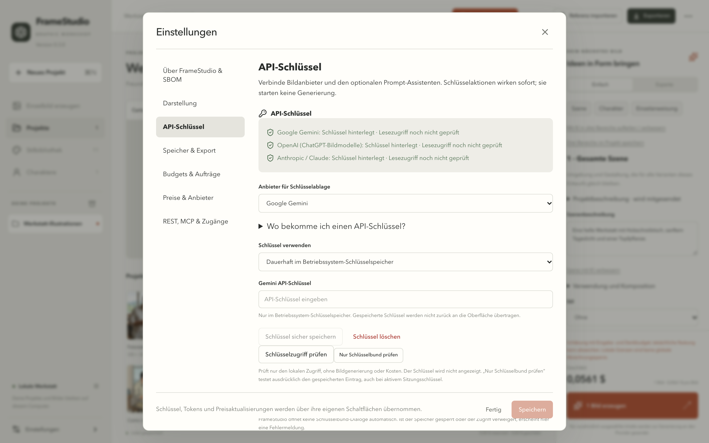

## Projekte anlegen und ordnen

**Neues Projekt** klicken oder **Cmd+N** (Windows: **Strg+N**) drücken. Einen gut erkennbaren Namen und eine kurze Beschreibung vergeben. Das Projekt kann Standardstil, Seitenverhältnis und Ausgabeeinstellungen speichern. Geöffnet wird es über **Projekte** oder seinen Eintrag in der Seitenleiste.

Über das Menü **Projektaktionen** (drei Punkte oben rechts) gibt es **Projektvorgaben**, Duplizieren, Archivieren und Projektsicherung. Archivieren behält Projekt und Bilder. **Archiv anzeigen** in der Seitenleiste öffnet archivierte Projekte; dort im Aktionsmenü **Wiederherstellen** wählen, um ein Projekt wieder zu aktivieren.

Um ein Projekt aus der Übersicht zu entfernen, auf seiner Projektkarte **Projekt löschen** wählen und das Verschieben in den Papierkorb bestätigen. Das lässt sich rückgängig machen: Über **Papierkorb** in der Projektübersicht kann es wiederhergestellt werden. Bilder, Auftragsverlauf und Kosten bleiben im lokalen Papierkorb erhalten; es wird kein Speicherplatz endgültig freigegeben.

## Prompts in drei Bereichen aufbauen

Der Projektgenerator trennt wiederverwendbare Inhalte von der Anweisung für ein einzelnes Bild:

| Bereich | Beispiel |
|---|---|
| Szene | Eine helle Werkstatt, Holzschreibtisch, sanftes Tageslicht und eine Topfpflanze |
| Charakter | Ein freundlicher Retro-Roboter mit Messinggelenken und rundem blauem Display |
| Einzelanweisung | Der Roboter winkt mit der rechten Hand und schaut zum Betrachter |

Mit den Bereichsschaltflächen springt man direkt zum jeweiligen Abschnitt. **Drei Bereiche im Projekt speichern** legt den wiederverwendbaren Entwurf ab. Vor dem Senden **Zusammengesetzter Prompt** prüfen: Projektbeschreibung, Stil, Charakterdefinition, Referenzen und Einzelanweisung werden zu einer Anfrage zusammengefügt. Jeder gesendete Auftrag behält seinen historischen Stand; spätere Änderungen an einer Vorlage schreiben ihn nicht um.

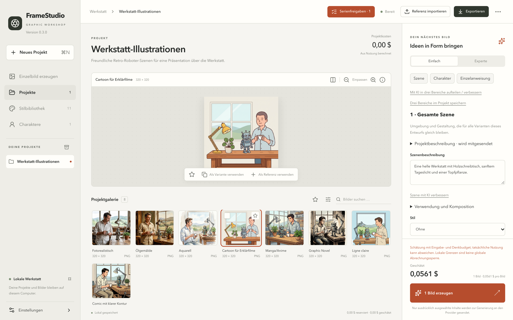

Der Expertenmodus zeigt modellspezifische Einstellungen und weitere Prompt-Felder. Nur Parameter verwenden, die für das gewählte Modell angeboten werden. Seitenverhältnisse, native Auflösung und Ausgabeformate unterscheiden sich je nach Anbieter und Modell. Größenänderungen beim Export sind von der nativen Auflösung der Erzeugung unabhängig.

### Prompts mit Claude verbessern

Zuerst den Anthropic-Schlüssel einrichten. Für den jeweiligen Bereich **Szene mit KI verbessern**, **Charaktertext mit KI verbessern** oder **Prompt mit Claude verbessern** verwenden. **Mit KI in drei Bereiche aufteilen / verbessern** bearbeitet alle drei zusammen. Vor dem Übernehmen Kostenschätzung und Textvorschlag des Assistenten prüfen. Anfragen an den Text-Assistenten können Geld kosten; die Bilderzeugung ist ein eigener Schritt mit eigenen Kosten.

Claude liefert Textvorschläge, keine Bilder. Ohne Assistenten-Schlüssel bleibt die Bearbeitung von Hand möglich.

## Referenzen importieren und entfernen

**Referenz importieren** fügt dem aktuellen Projekt ein Bild hinzu. Im Generator über **Referenzen** oder die Bildaktion **Als Referenz verwenden** für den aktuellen Entwurf auswählen. Gesendet werden nur ausgewählte Inhalte.

Eine ausgewählte Referenz mit ihrem **×** entfernen. Das entfernt sie aus dem Entwurf, nicht aus der Galerie. Ein gespeicherter Charakter hat eine eigene Referenzauswahl und Freigabe; um diese Referenzen zu entfernen, den Charakter bearbeiten. Ein Bild aus der Galerie zu entfernen ist eine eigene Aktion in den Bilddetails und verändert frühere Aufträge nicht.

Ein Bild in der großen Vorschau ist nicht automatisch eine Referenz für die Erzeugung. Vor dem Start die Referenzauswahl des Entwurfs prüfen.

## Stile und Vorschaubilder

Die **Stilbibliothek** zeigt die bearbeitbaren Vorlagen. Die mitgelieferten neutralen Vorschauen sind ohne kostenpflichtige Anfrage verfügbar. Ein Stil beschreibt Medium, Linien, Farbpalette, Licht und Textur; sein Vorschaubild veranschaulicht diese Eigenschaften und wird nicht automatisch mit jedem Bild als Referenz gesendet.

**Bearbeiten** ändert einen Stil, **Duplizieren** legt eine eigene Fassung an. **Vorschau gestalten** öffnet einen Entwurf für ein Vorschaubild. Anbieter und Kosten prüfen, erzeugen und für das gewünschte Ergebnis **Als Stilvorschau übernehmen** wählen. Vorhandene Vorschauen müssen nicht neu erzeugt werden, um einen Stil zu verwenden.

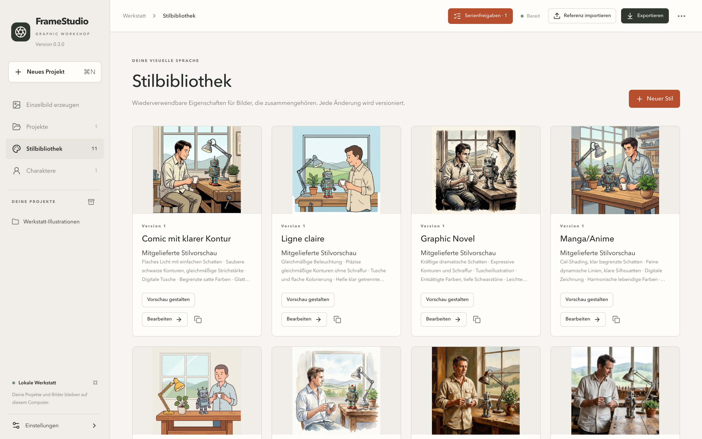

## Charaktere und Serien

Einen Charakter unter **Charaktere** oder über **Neuer Charakter** im Generator anlegen. Wiedererkennbare Merkmale, Kleidung und Farben festhalten. Referenzbilder auswählen und, wenn gewünscht, ausdrücklich für Generierungen freigeben. Als Anzeigebild das passende erzeugte Bild wählen; Anzeigebild und Referenzen für die Erzeugung erfüllen unterschiedliche Zwecke.

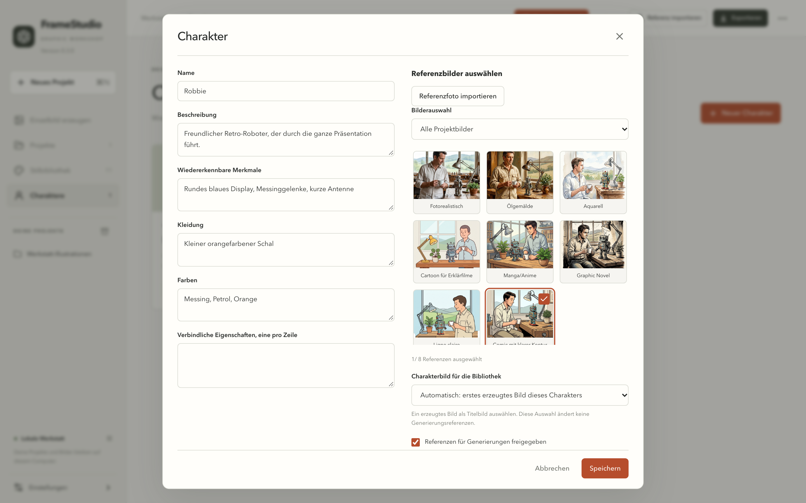

Mit **Charakterset planen** lassen sich Ansichten, Posen, Gesichtsausdrücke und Mundformen vorbereiten. Vor dem Start die tatsächliche Liste und die Gesamtzahl prüfen, damit nicht versehentlich jede mögliche Kombination entsteht. Modelle können die Identität einer Figur zwischen Bildern verändern, auch mit denselben Referenzen.

### Eine Serie aus REST oder MCP einmal freigeben

**Serienfreigaben** öffnen. Beschreibung, Herkunft (Schnittstelle), Empfänger des Zugangs, Zielprojekt, die genauen geplanten Bilder und die geschätzten Gesamtkosten prüfen. Wo passende Alternativen angeboten werden, den eingerichteten Anbieter bzw. das Modell wählen und die neu berechnete Schätzung prüfen. Die Auswahl eines Anbieters nutzt dessen aktiven Sitzungsschlüssel oder gespeicherten Schlüssel; der Schlüssel selbst wird nicht angezeigt.

Überschreitet die Serie die normale Startgrenze pro Auftrag, bietet der Dialog eine ausdrückliche einmalige Grenze nur für diese Serie an. Das Projektbudget gilt weiterhin. Die ganze Serie einmal freigeben: Jedes aufgeführte Bild wird ein dauerhafter Auftrag und mit der eingestellten Parallelität verarbeitet. Eine spätere Serie oder ein geänderter Plan braucht eine eigene Freigabe.

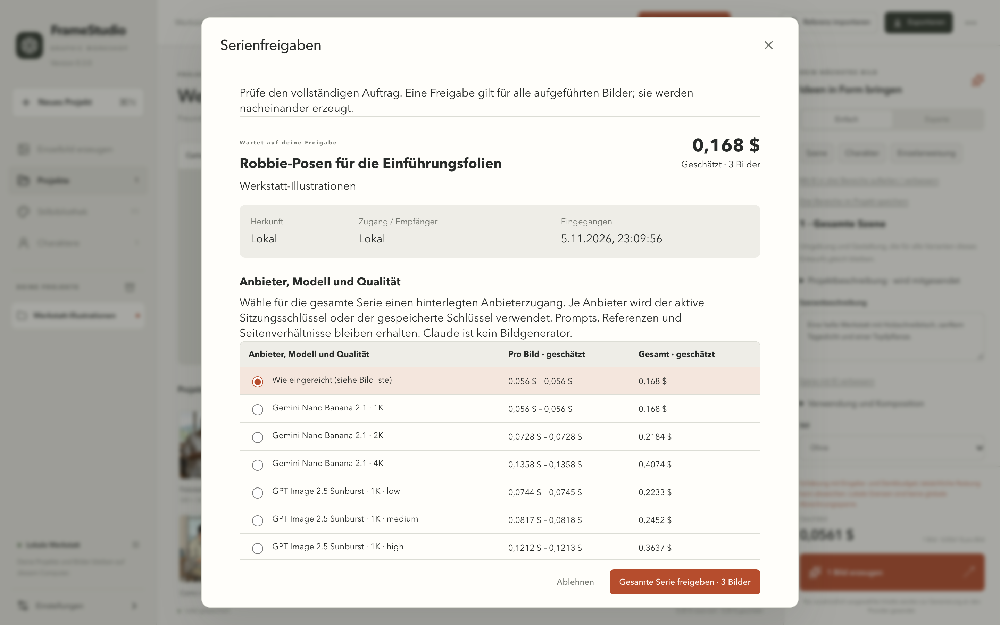

Bei Sitzungsschlüsseln muss dieselbe laufende App die Arbeit verarbeiten. Nach einem Neustart den Schlüssel erneut aktivieren und nicht einfach eine doppelte Serie anlegen. Zuerst die vorhandenen Aufträge ansehen.

## Aufträge, Fehler und Kosten

Die Auftragsanzeige zeigt wartende, laufende und abgeschlossene Arbeit, Fehler und mögliche Abbrüche. Ein Fortschrittsbalken für Serien zählt fertige Bilder. Innerhalb einer einzelnen Bildanfrage liefert der Anbieter oft keinen Fortschritt; die App täuscht keinen vor.

| Kostenangabe | Bedeutung |
|---|---|
| Geschätzt | Prognose aus Modell, Eingaben und gespeicherter Preistabelle |
| Aus Usage berechnet | Berechnet aus den Usage-Angaben des Anbieters und der Preisgrundlage des Auftrags |
| Vom Anbieter bestätigt | Ein ausdrücklich vom Anbieter gelieferter Betrag |
| Unbekannt | Kein verlässlicher tatsächlicher Betrag verfügbar; das ist nicht null |

Warnschwelle, Startgrenzen, Projektbudgets und Parallelität unter **Einstellungen → Budgets & Aufträge** festlegen. Datierte Preise und unterstützte Preisaktualisierungen stehen unter **Preise & Anbieter**. Historische Aufträge behalten ihre Preisgrundlage. Lokale Grenzen begrenzen keine Kosten anderer Apps und sind keine globale Abrechnungsgrenze beim Anbieter.

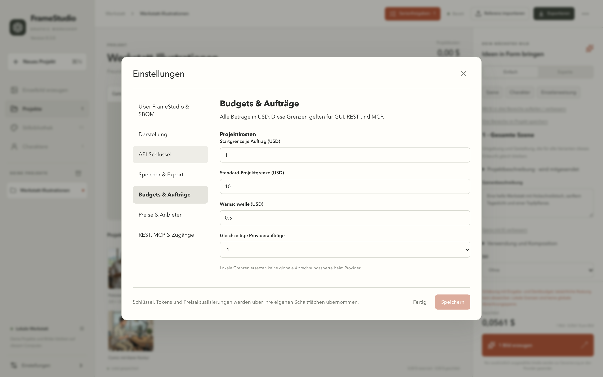

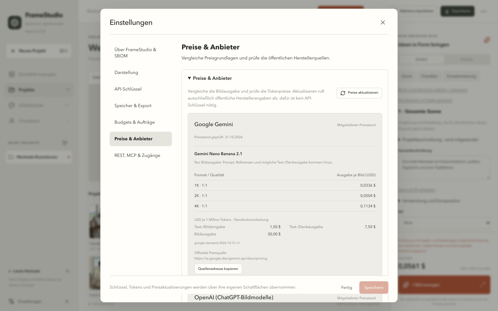

USD-Schätzungen sind keine Euro-Rechnung inklusive Steuern. Die Abrechnung des Anbieters kann Währungsumrechnung, Steuern, andere Anfragen und Verzögerungen enthalten. Beträge nur bei gleichem Anbieter, Zeitraum und gleicher Nutzung vergleichen.

Nachdem eine Anfrage an den Anbieter gesendet ist, erfolgt ein Abbruch nur nach Möglichkeit. Auch ein unklares Ergebnis nach Zeitüberschreitung kann Kosten verursachen. Vor einem bewussten neuen Versuch Fehler und Status prüfen; jeder Versuch ist eine weitere Anfrage.

## Ein Bild, eine Auswahl oder eine ganze Serie exportieren

**Ein Bild oder ausgewählte Bilder:** Auf den Galeriekarten die Auswahlfelder verwenden, dann **Auswahl exportieren**. Ein Bild zum Ansehen anzuklicken ist nicht dasselbe wie es für den Export auszuwählen. **Sichtbare auswählen** gilt für die sichtbare Galerieseite.

**Ganzes Projekt:** Die Auswahl aufheben und oben auf **Exportieren** klicken. Der Dialog muss **Ganzes Projekt** anzeigen. Das kann importierte Referenzen einschließen.

**Ganze erzeugte Serie:** **Serienfreigaben** öffnen, die Serie suchen und **Serie exportieren** klicken. Alle derzeit gespeicherten Ergebnisse dieser Serie werden in Reihenfolge gesammelt, auch von anderen Galerieseiten. Referenzen und andere Serien sind ausgeschlossen. Wer alle geplanten Ergebnisse in einem Export möchte, wartet, bis die Serie fertig ist.

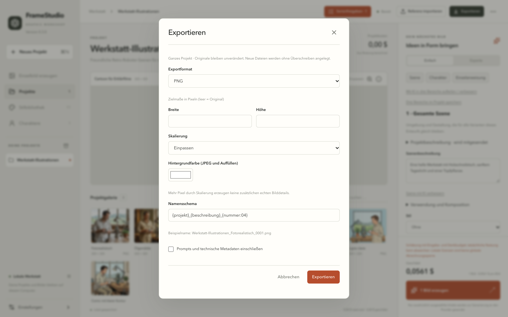

| Format | Geeignet für |
|---|---|
| Originaldateien | Unveränderte Dateien von Anbieter oder Import |
| PNG | Verlustfreies Teilen; vorhandene Transparenz bleibt erhalten |
| JPEG | Kompakte Bilder ohne Transparenz; Hintergrundfarbe ausdrücklich wählen |
| WebP oder TIFF | Web- bzw. Druckvorstufen-Workflows |
| Offline-HTML-Galerie | Auswahl ohne Server ansehen |
| PDF | Ein Bild pro Seite oder Kontaktbogen |
| PowerPoint / PPTX | Ein Bild pro Folie oder Kontaktlayout; Texte bleiben bearbeitbar |
| Sprite-Sheet + JSON | Feste Zellen, Abstand, Reihenfolge und Metadaten-Manifest |
| ZIP-Projektpaket | Projekt mit versioniertem Manifest übertragen oder wiederherstellen |

Zielabmessungen leer lassen, um die Originalauflösung zu behalten. Einpassen, Zuschneiden oder Rand bewusst wählen; Zuschneiden kann Teile einer Figur entfernen. Vergrößern erzeugt keine echten neuen Details. PNG erhält vorhandene Transparenz; eine Konvertierung allein entfernt keinen Hintergrund.

Dokumenttitel, Beschriftungen, Seiten-/Folienlayout und Sprite-Zellen prüfen, wenn diese Optionen erscheinen. **Prompts und technische Metadaten einschließen** zum Teilen ausgeschaltet lassen, wenn diese Angaben nicht weitergegeben werden sollen. Schlüssel und Zugriffstokens sind nie Teil eines Projektexports.

**Exportieren** klicken, auf den Abschluss warten und dann **Im Dateimanager anzeigen** verwenden. Originalbilder bleiben erhalten; Exporte überschreiben sie nicht.

## Sichern, wiederherstellen und Arbeitsbereich wechseln

**Projektaktionen → Projekt sichern** verwenden oder im Export **ZIP-Projektpaket** wählen. Für eine vollständige Sicherung vorher die Galerieauswahl aufheben und die gewünschten Metadaten einschließen. Sicherungen außerhalb des Arbeitsordners aufbewahren, wenn eine getrennte Kopie gebraucht wird.

**Projekt-ZIP importieren** stellt ein Paket als weiteres Projekt wieder her. Ein vorhandenes Projekt wird dabei nicht überschrieben.

Unter **Einstellungen → Speicher & Export** ein leeres Verzeichnis oder einen vorhandenen FrameStudio-Arbeitsbereich wählen. Die eigene Schaltfläche zum Wechsel des Arbeitsbereichs verwenden und die App neu starten. Das ändert den aktiven Speicherort; der bisherige Arbeitsbereich wird weder verschoben noch gelöscht. Projekte zwischen Arbeitsbereichen per Projekt-ZIP exportieren und importieren. Das Exportverzeichnis ist eine eigene Einstellung.

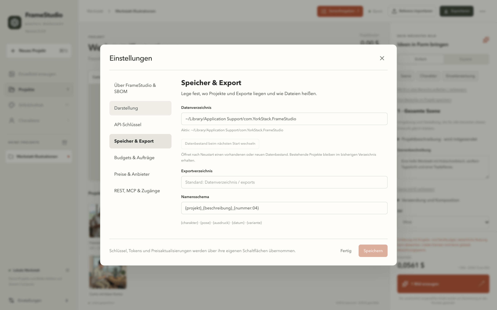

## REST- und MCP-Zugriff

Diese Schnittstellen sind optional und anfangs ausgeschaltet. Unter **Einstellungen → REST, MCP & Zugänge** die benötigte Schnittstelle aktivieren. REST läuft nur lokal (Loopback), MCP über stdio. Beide nutzen dieselben Projekte, Budgets und Auftragsregeln wie die Oberfläche.

Für jedes Programm und jede Person einen eigenen Zugang anlegen und Empfänger und Zweck notieren. Den Token beim ersten Anzeigen kopieren und sicher im Client hinterlegen; er lässt sich später nicht noch einmal anzeigen. Provider-Schlüssel und lokale Zugriffstokens sind verschiedene Zugangsdaten.

Die kompakte Liste zeigt zunächst aktive Einträge. Einen Eintrag aufklappen, um Details zu sehen, und mit der Widerrufen-Aktion den Token ungültig machen. Die Ansicht der widerrufenen Zugänge ist Verlauf: Ein als **Widerrufen** markierter Token ist bereits ungültig und kann nicht ein zweites Mal widerrufen werden. Der Widerruf eines Tokens bricht einen bereits freigegebenen Auftrag nicht ab; Aufträge getrennt verwalten.

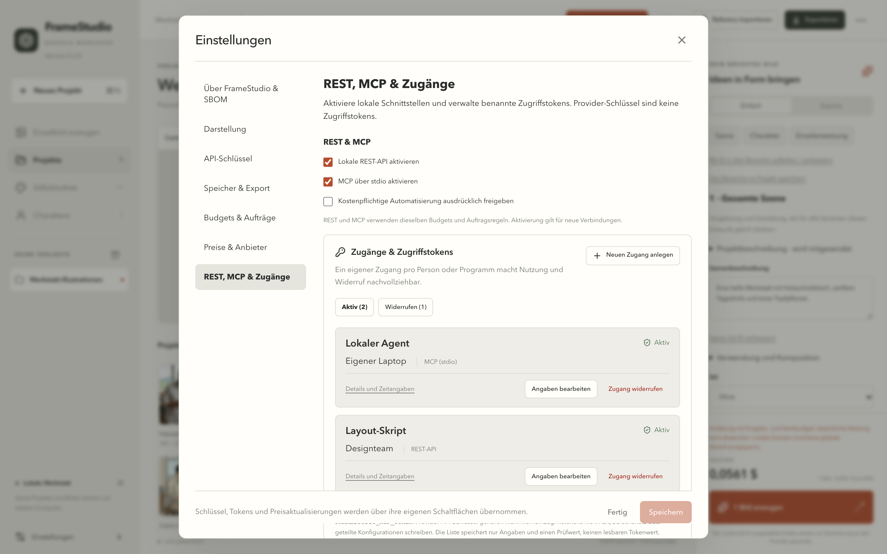

Befehle, Bereiche, Headless-Betrieb und Client-Beispiele stehen in [REST und MCP](API.md) und im [Operationsvertrag](CONTRACT.md). Ein gehostetes Modell kann localhost oder stdio dieses Rechners nicht direkt erreichen; ein lokaler Client muss die Verbindung herstellen.

## Fehlerbehebung

| Problem | Was prüfen |
|---|---|
| Erzeugen ist ausgegraut | Anweisung eingeben, verfügbaren Anbieter wählen und auf eine gültige Schätzung warten; angezeigte Hinweise lesen |
| Schlüssel eingegeben, aber nicht aktiv | **Für diese Sitzung verwenden** oder **Schlüssel sicher speichern** klicken, nicht nur das allgemeine Speichern |
| Schlüsselbundzugriff verweigert | Unter macOS die **Schlüsselbundverwaltung** öffnen (nicht „Passwörter“) und den FrameStudio-Eintrag und die Berechtigung für die aktuelle App prüfen. Auch ein entsperrter Schlüsselbund kann nach einem neuen Build den Zugriff verweigern. Währenddessen einen Sitzungsschlüssel verwenden; den Schlüsselbund nicht zurücksetzen und nicht allen Apps Zugriff geben. Siehe [Schlüsselbund-Fehlerbehebung](KEYCHAIN.md) |
| Anbieter lehnt die Anfrage ab | Den ausführlichen Auftragsfehler lesen; Modellzugang, unterstützte Parameter, Abrechnung, Guthaben und Kontingent prüfen. Die lokale Schlüsselprüfung prüft diese Punkte nicht |
| Serie scheint festzustecken | Auftragszahlen und Status, den Schlüssel des gewählten Anbieters und die vorhandene Freigabe prüfen. Nach einem vollständigen Neustart den Sitzungsschlüssel erneut aktivieren |
| Im Export fehlen Bilder | Ausgewählt, sichtbar oder ganzes Projekt? Für alle gespeicherten Ergebnisse einer Serie **Serie exportieren** verwenden |
| Projekt nach Ordnerwechsel verschwunden | Der neue Arbeitsbereich ist getrennt; zurückwechseln oder ein Projekt-ZIP importieren |
| Deutscher Text im englischen Modus | Prompt-Inhalte von Projekten und Stilen und einige Abschnittsbezeichnungen im zusammengesetzten Prompt sind Daten und bleiben in Version 0.3.0 deutsch; sie lassen sich unabhängig bearbeiten |

Für eine Fehlermeldung App-Version, Betriebssystem und Version, Schritte und Fehlercode angeben. Keine Schlüssel, Zugriffstokens oder privaten Prompts und Fotos beifügen. **Einstellungen → Über FrameStudio & SBOM → SBOM als JSON exportieren** liefert das Abhängigkeitsinventar; das ist keine Sicherheitsbewertung.

## Umfang dieser Version

Die veröffentlichten Programme laufen auf macOS mit Apple Silicon und Windows x64. Die macOS-App ist nicht mit einer Apple Developer ID signiert oder notarisiert, der Windows-Installer hat keine Authenticode-Signatur. Diese Version erzeugt Bilder und Figuren, keine Videos, kein Audio und keine automatische Lippensynchronisation. Die Screenshots zeigen einen separaten Beispiel-Arbeitsbereich mit mitgelieferten Beispielbildern; sie enthalten keine persönlichen Projekte und es wurden keine kostenpflichtigen Erzeugungen ausgeführt.
