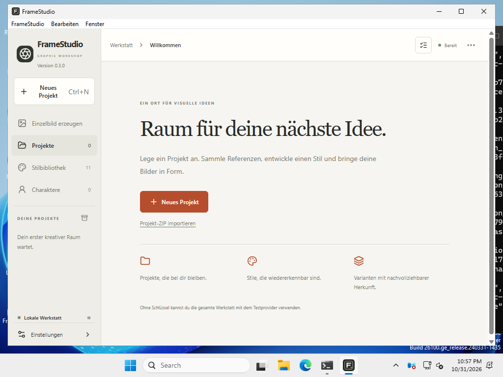

# Windows x64: Installation und Build

*English: [../WINDOWS.md](../WINDOWS.md)*

FrameStudio verwendet unter Windows denselben Rust-Kern und dieselbe React-Oberfläche wie unter macOS. Das Windows-Paket ist ein NSIS-Installer für 64-Bit-Windows auf Intel/AMD. Native ARM64- und 32-Bit-Pakete gibt es nicht.

## Installieren

Die Windows-`-setup.exe` von der GitHub-Release-Seite herunterladen, ausführen und Deutsch oder Englisch wählen. Die Installation erfolgt pro Benutzer und braucht normalerweise keine Administratorrechte. Fehlt Microsoft WebView2, lädt der Installer es herunter und installiert es; dafür ist eine Internetverbindung nötig. Node.js, Rust, Python, Docker oder ein Datenbankserver werden für die Nutzung nicht gebraucht.

Dieses frühe Windows-Paket hat noch keine Authenticode-Herausgebersignatur, deshalb kann Windows SmartScreen warnen. Wer dem Download vertraut, wählt **Weitere Informationen → Trotzdem ausführen** (vorher mit `WINDOWS-SHA256SUMS` aus dem Release vergleichen). Die Sicherheitsrichtlinie einer Organisation kann die Installation ganz verhindern. Keine Systemschutzfunktionen abschalten; verwaltete Installationen sollte die Administration prüfen.

**Einstellungen → API-Schlüssel** öffnen und den eigenen Anbieter-Schlüssel eintragen. Dauerhafte Schlüssel liegen in der Windows-Anmeldeinformationsverwaltung, Sitzungsschlüssel nur im laufenden Prozess. Der macOS-Schlüsselbund spielt unter Windows keine Rolle. Unter **Einstellungen → Speicher & Export** einen lokalen Arbeitsbereich wählen; beim Ordnerwechsel wird der Inhalt nicht automatisch verschoben.

[Schnellstart](QUICKSTART.md) und [Benutzerhandbuch](USER-GUIDE.md) gelten auch für Windows; die Screenshots stammen von macOS. Statt **Cmd** wird unter Windows **Strg** verwendet.

## Build nachvollziehen

Unter Windows die in [CONTRIBUTING.md](../../CONTRIBUTING.md) genannten festen Versionen von Node, npm und Rust installieren, außerdem Python 3.11 oder neuer sowie die von Tauri benötigten Visual-Studio-C++-Buildtools und das Windows SDK. Dann:

```powershell
npm ci
npm run build
cargo test --manifest-path src-tauri/Cargo.toml --locked --no-default-features
cargo clippy --manifest-path src-tauri/Cargo.toml --locked --all-targets -- -D warnings
npm run tauri -- build --bundles nsis -- --locked
```

`src-tauri/tauri.windows.conf.json` wird unter Windows automatisch zusammengeführt. Ergebnis: `src-tauri/target/release/bundle/nsis/FrameStudio_0.3.0_x64-setup.exe`.

Der manuell gestartete [Windows-Installer-Workflow](../../.github/workflows/windows-release.yml) führt die Tests aus, außerdem einen synthetischen Schreib-/Lese-/Ersetzen-/Löschtest gegen den nativen Schlüsselspeicher, Clippy, Abhängigkeitsprüfung, Paketbau, stille Installation, REST-/Export-/Neustart-Abnahme mit dem installierten Programm und einen Starttest des nativen Fensters. Er lädt Installer und Nachweise zur Prüfung hoch; ein Release veröffentlicht er nicht automatisch.

Ein Starttest ersetzt keine vollständige interaktive Abnahme der Windows-Oberfläche. Der Workflow stellt keine kostenpflichtigen Anfragen. Die plattformübergreifenden Tests decken echte REST- und MCP-Verbindungen ab; das installierte Programm wird zusätzlich über REST geprüft.

Der Paketbau folgt der offiziellen [Tauri-Dokumentation zum Windows-Installer](https://v2.tauri.app/distribute/windows-installer/), geprüft am 31.10.2026. Die Windows-Konfiguration benötigt keine neue Laufzeitabhängigkeit, Datenbankmigration, Tauri-Berechtigung oder Lockerung der CSP.

## Windows-Abnahme · 31.10.2026

Das x64-Paket wurde aus [7871eb654ba2ee6aafe74a2fb94ca518f7846b1b](https://github.com/YorkStack/FrameStudio/commit/7871eb654ba2ee6aafe74a2fb94ca518f7846b1b) gebaut, also nach dem ursprünglichen macOS-Tag 0.3.0. Tag und macOS-Programme sind unverändert. Zum Nachbauen des Windows-Pakets genau diesen Commit verwenden.

Umgebung: GitHub-gehostetes Windows Server 2025 x64 (Image `windows-2025-vs2026`), MSVC-Toolchain, Rust 1.98.1, Node 24.22.1 und npm 12.2.1. [Build-Protokolle und Nachweise](https://github.com/YorkStack/FrameStudio/actions/runs/41249852482).

| Prüfung | Ergebnis |
|---|---|
| Kern- und Integrationstests | 128 bestanden, 3 zunächst übersprungen; einschließlich echter REST- und MCP-Verbindungen über das offizielle SDK |
| Nativer Windows-Schlüsselspeicher | Zusätzlicher ausdrücklicher synthetischer Schreib-/Lese-/Ersetzen-/Löschtest bestanden |
| Rust-Formatierung, Clippy, Frontend-Build | Bestanden |
| npm audit | Zum Prüfzeitpunkt keine bekannten Schwachstellen |
| NSIS-Installer | Gebaut, still installiert, Version des installierten Programms geprüft |
| REST-Abnahme mit installierter App | Projekt, Stil, Referenz, Charakter und 3 Testvarianten; Idempotenz und Persistenz nach Neustart bestanden |
| Exporte | Original, PNG, JPEG, WebP, TIFF, HTML, PDF, PPTX, Sprite-Sheet und Projekt-ZIP exportiert und gelesen; ZIP wiederhergestellt |
| Native Oberfläche | Fenster sichtbar und reagiert; Außenmaße passen in den Arbeitsbereich des Monitors einschließlich Taskleiste und Rahmen |
| Kleine Fenster | Zwei gezielte Playwright-Tests lokal bestanden; nativer Windows-Screenshot separat geprüft |

Diese Prüfungen verwenden keine Anbieter-Geheimnisse und keine kostenpflichtigen Anfragen. Der Schlüsselspeichertest legt isolierte synthetische Einträge an und entfernt sie wieder. Die Exporttests prüfen Dateiinhalte und die Wiederherstellung aus dem Projekt-ZIP; die Darstellung von PDF/PPTX in Windows-Programmen wurde nicht geprüft. Offen sind ein vollständiger manueller Test unter Windows 10/11 und eine echte kostenpflichtige Bilderzeugung unter Windows. Native ARM64- und x86-Builds gibt es nicht.

Windows-spezifische Korrekturen: unterstützte native Menüaktionen, Strg+N als Tastenkürzel, eine scrollbare kompakte Seitenleiste, erreichbare Dialogaktionen und ein Startfenster, das in den Arbeitsbereich des Monitors passt. Laufzeitabhängigkeiten, Berechtigungen, CSP und Datenbankschema sind unverändert.

Nativer Screenshot der installierten Windows-Version (CI-Desktop mit 1024 × 768):



Das installierte Headless-Programm war in dieser einzelnen CI-Messung nach 290,35 ms für REST bereit. Das ist weder die Startzeit der Oberfläche noch ein Messwert auf Verbraucherhardware. Der Gesamtspeicherbedarf unter Windows wurde nicht gemessen.
